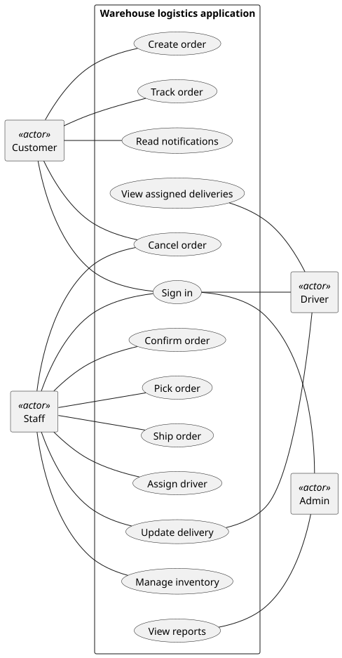
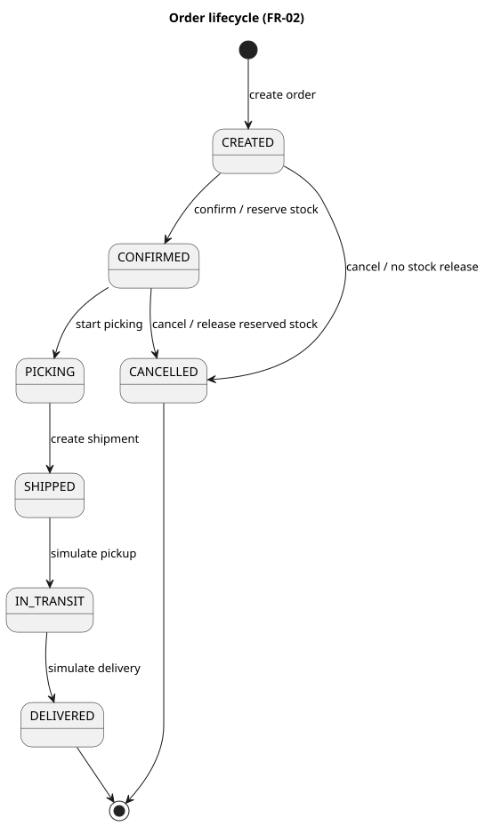
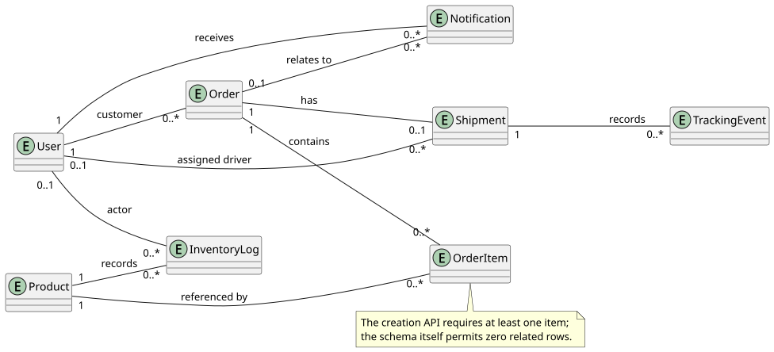
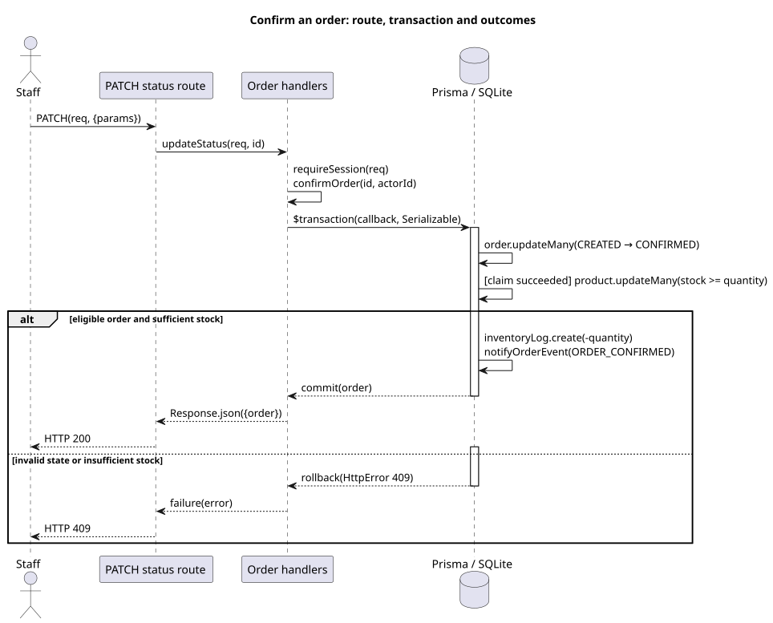

# COMP 3500 Final Report — Warehouse Logistics Management System

Repository: [Et1enneee/comp3500-logistics](https://github.com/Et1enneee/comp3500-logistics). Markdown links resolve from this report. Code and test paths such as `lib/` and `tests/` are relative to the application directory `logistics-foundation/`; CI and other explicitly root-relative paths are relative to the repository root.

## 1. Introduction and scope

The project has two goals: make the decisions affecting an order traceable from requirement to implementation and test; and provide a coherent workflow separated by user role. The application uses Next.js, TypeScript, Prisma and SQLite to manage a single warehouse, inventory, orders and simulated delivery on a local deployment.

| Role | Responsibility |
|---|---|
| Customer | Place and track own orders; read notifications and cancel eligible orders. |
| Staff | Confirm, pick and ship orders, manage inventory and assign drivers. |
| Driver | View assigned deliveries and simulate pickup and delivery. |
| Admin | View operational reports and export aggregates. |

The primary stakeholders are these user roles; operational concerns such as deployment and data integrity are addressed by the constraints in §3. The «system» boundary contains the local application and its database; the four users interact with the application as external actors. Real GPS, barcode scanning, recipient telephone collection, payment and carrier integration are outside the defined scope. See [driver module](../logistics-foundation/docs/driver-module.md) and [scope record](../logistics-foundation/docs/closure/scope-and-srs-addendum.md).

## 2. Development process

The project is presented as plan-driven incremental development: each increment has a trigger, scope and exit criterion, with short feedback cycles and continuous integration inside the increments. The records establish integration and verification, rather than release to external users. The descriptions and exit criteria below are reconstructed from surviving artefacts; the [increment register](../logistics-foundation/docs/process/increments.md) identifies their evidence.

**Table 2.1 — Increment definitions**

| Increment | Date | Trigger | Scope | Exit criterion | Evidence |
|---|---|---|---|---|---|
| Project planning | 9 and 11 Oct 2026 | Logistics project selection | Define responsibilities, contracts and initial order-management scope. | Record contracts and requirement IDs. | [Change log](../repo-init/CHANGELOG.md); [initial README](../repo-init/README.md) |
| Early test-led review | 17 Oct 2026 | Initial order and inventory functionality needed assessment. | Execute cases for creation, transitions, tracking and alerts, and record discrepancies. | Record actual outcomes against cases. | [Historical defect record](../logistics-foundation/docs/reference/legacy/Jaden-defects.md) |
| Order confirmation behind the HTTP interface | 26–28 Oct 2026 | The early defect record identifies a failed confirmation endpoint and missing ledger. | Confirm a created order through the HTTP status route, reserving stock and recording the ledger within a transaction. | Record a successful confirmation and a rejected repeat with database observations. | [Order query and confirmation verification record (订单查询与确认功能验证记录)](../logistics-foundation/docs/verification-original-1026.md); `git show 0d9f400` |
| Integrated role-based application | 1 Nov 2026 | Integrate the verified foundation into an application. | Combine customer ordering, staff operations and administrative reporting with authenticated access. | Preserve the integrated source and version record. | `git show f2693fd`; [version record](../logistics-foundation/BASELINE-v0.4.2.json) |
| Simulated driver delivery and staff privacy | 2 Nov 2026 | Delivery assignment and address minimisation required implementation. | Add assigned delivery tasks and minimise customer address data exposed to staff. | Integrate driver and privacy tests. | [Driver module](../logistics-foundation/docs/driver-module.md); `tests/driver.integration.ts` |
| Post-presentation documentation hardening | 10–11 Nov 2026 | Review found differences among models, requirements records and implementation. | Align diagrams and traceability with code and regenerate verification evidence. | Record the changes and test results against an identified baseline. | [Audit](../logistics-foundation/docs/audit-2026-11-10.md); §10 |

Configuration management has three components. **Version management** uses Git; the annotated `v0.3.1` and `v0.4.2` tags were applied retrospectively. **System integration** uses the [repository-root CI workflow](../.github/workflows/ci.yml), triggered for the named push branches, pull requests and manual runs. **Problem tracking** uses the [issue tracker](https://github.com/Et1enneee/comp3500-logistics/issues), supported by the [known-issues register](../logistics-foundation/docs/known-issues.md) and [incident record](../evidence/incident-reports/ci-concurrency-cancellations.md).

## 3. Requirements

The specification is maintained at [docs/requirements/srs.md](../logistics-foundation/docs/requirements/srs.md). It defines priorities, rationales, sources and verification for each requirement; the [traceability matrix](../logistics-foundation/docs/traceability.md) maps the specification to implementation and evidence.

### Customer

- **FR-01 — Create orders.** The system shall let a customer create an order containing product lines and a total. *This creates the entry point to the warehouse workflow.* Priority rationale: *Must: order creation enables the core workflow.* Source: scope decision, [historical register](../logistics-foundation/docs/reference/legacy/traceability-v0.md). Status: Implemented ([test](../logistics-foundation/tests/foundation.integration.ts)).
- **FR-03 — Number and track orders.** The system shall generate order and shipment identifiers and show an owner their order and tracking history. *Identifiers support retrieval of progress.* Priority rationale: *Must: identifiers support tracking throughout the workflow.* Source: scope decision, historical register. Status: Implemented ([test](../logistics-foundation/tests/logistics-chain.integration.ts)).
- **FR-05 — In-app notifications.** The system shall record notifications for defined order events and let the customer inspect and mark them as read. *Notifications communicate recorded progress.* Priority rationale: *Should: customers can also inspect the tracking page.* Source: scope decision, historical register. Status: Implemented ([test](../logistics-foundation/tests/notifications.integration.ts)).

### Staff

- **FR-02 — Order state changes.** The system shall enforce the order lifecycle, including confirmation and eligible cancellation, with stock reservation or release as specified in §4. *Controlled transitions protect inventory and order history.* Priority rationale: *Must: state and stock invariants protect the order workflow (RK-02).* Source: QA findings, [verification record](../logistics-foundation/docs/verification-original-1026.md). Status: Implemented ([test](../logistics-foundation/tests/orders.integration.ts)).
- **FR-04 — Inventory and alerts.** The system shall provide inventory information, replenishment, ledger views and a low-stock alert when available stock is below the product threshold. *Stock visibility supports replenishment decisions.* Priority rationale: *Must: inventory information supports confirmation and replenishment.* Source: scope decision, historical register. Status: Implemented ([test](../logistics-foundation/tests/inventory.integration.ts)).

### Driver

- **FR-08 — Simulated delivery.** The system shall let staff assign a shipped order and let an assigned driver view the task and simulate pickup and delivery. *Assignment provides a bounded delivery handoff.* Priority rationale: *Must for the current scope: assigned tasks complete the role workflow.* Source: scope decision, [driver module](../logistics-foundation/docs/driver-module.md). Status: Implemented ([test](../logistics-foundation/tests/driver.integration.ts)).

### Admin and shared access

- **FR-06 — Operational reports.** The system shall provide an administrator with aggregate order reports and CSV export. *Aggregates support operational review.* Priority rationale: *Should: core transactions remain usable without reports.* Source: scope decision, historical register. Status: Implemented ([test](../logistics-foundation/tests/reports.integration.ts)).
- **FR-07 — Access control.** The system shall authenticate users and enforce role and object-level access to applicable functions and records. *Access checks limit unauthorised operations.* Priority rationale: *Must: role and ownership checks protect data.* Source: scope decision, historical register. Status: Implemented ([test](../logistics-foundation/tests/auth.integration.ts)).

**Non-functional requirements.** The conditions and verification methods are recorded in the [current traceability matrix](../logistics-foundation/docs/traceability.md) and [historical register](../logistics-foundation/docs/reference/legacy/traceability-v0.md).

| ID | Requirement, conditions and target | Measure | Status / evidence |
|---|---|---|---|
| NFR-01 Performance | The system shall respond to core queries within 2 s and show list first paint within 3 s. These are subcriteria of one requirement. Priority rationale: *Must: response targets support interactive use.* | Measure HTTP response and first-contentful-paint; §6 also reports the first-row/card proxy. | Measured ([performance](../logistics-foundation/evidence/performance.json)) |
| NFR-02 Availability | The system shall start and serve the designated browser suite at an integration point. Priority rationale: *Must: role workflows require a running local application.* | Build, start and run the browser suite on the identified source. | Verified at 40 integration points ([observations](../logistics-foundation/evidence/availability/integration-observations.json)) |
| NFR-03 Least privilege | The system shall restrict operations and record visibility to authorised roles and users. Priority rationale: *Must: access checks support role separation and privacy.* | Execute role, object-ownership and privacy tests against expected HTTP responses and fields. | Implemented ([tests](../logistics-foundation/tests/privacy.integration.ts)) |
| NFR-04 Scripted operation effort | The system shall support each selected operation in at most three scripted major actions from its prepared screen. Priority rationale: *Should: short operations support role workflows.* | Count scripted fills, selections and clicks. | Verified for 11 selected operations ([walkthrough](../logistics-foundation/evidence/user-validation/automated-walkthrough.md)) |
| NFR-05 Process quality | The project shall apply code checks, contracts and continuous integration to the configured branches and pull requests. Priority rationale: *Must: repeatable checks expose integration failures (RK-04).* | Inspect workflow outcomes and the manifest verification step. | Implemented ([CI](../.github/workflows/ci.yml)) |

Must and Should priorities in the historical register express the project's scope priorities; the reconstructed rationales link essential workflow and access needs to the risk register and supporting records. They are shared by multiple requirements, not exclusive to inventory.

**Table 3.1 — Risk-to-requirement coverage**

The complete five-column register, including severity and historical status, is [risk-coverage.md](../logistics-foundation/docs/requirements/risk-coverage.md). Its relationships are reconstructed from the [risk register](../logistics-foundation/docs/reference/legacy/risks.md).

| Risk and severity (probability/impact) | Addressed by | Mitigation | Verification | Status |
|---|---|---|---|---|
| RK-01 Scheduling mismatch, medium/high | [Increment register](../logistics-foundation/docs/process/increments.md) | Checkpoints and defined work | Risk register; Table 2.1 | Managed — [increment register](../logistics-foundation/docs/process/increments.md); register open |
| RK-02 Uncoordinated contract changes, medium/high | FR-02, NFR-05 | Central transition table and checks | `lib/constants.test.ts`; CI | Mitigated — [transition test](../logistics-foundation/lib/constants.test.ts); register mitigated |
| RK-03 Assessment-week capacity, high/medium | [Priority register](../logistics-foundation/docs/reference/legacy/traceability-v0.md) | Prioritise core chain | Risk and historical priority registers | Managed — [increment register](../logistics-foundation/docs/process/increments.md); register open |
| RK-04 Local setup or CI delay, low/medium | NFR-05 | Setup commands and CI | Workflow; `package.json` | Managed — [CI workflow](../.github/workflows/ci.yml); register open |
| RK-05 Demo data reproducibility, low/high | FR-01/04/06; NFR-05 | Guarded deterministic seed | `prisma/seed.ts`; `tests/seed.integration.ts` | Managed — [seed test](../logistics-foundation/tests/seed.integration.ts); register open |
| RK-06 Competing assignments, high/high | [Risk plan](../logistics-foundation/docs/reference/legacy/risks.md) | Schedule around assessment peaks | Risk register | Managed — [increment register](../logistics-foundation/docs/process/increments.md); register open |
| RK-07 Stack learning curve, high/medium | NFR-05 supporting tooling | Setup guide and checks | README; workflow | Managed — [setup guide](../logistics-foundation/README.md); register open |
| RK-08 Report and video schedule, medium/high | [Risk plan](../logistics-foundation/docs/reference/legacy/risks.md) | Freeze and rehearse demonstration | Risk register | Managed — [increment register](../logistics-foundation/docs/process/increments.md); register open |

Status key: mitigated means a recorded mitigation; managed means a documented mechanism, while the historical register status remains as shown.

**Table 3.2 — Requirements review checks**

| Check | Review conclusion and evidence |
|---|---|
| Validity | Role workflows correspond to implemented functions; the human validation protocol in §8 assesses fitness for purpose. |
| Consistency | Current transition table and code agree; historical model differences are reconciled in §9. |
| Completeness | The SRS and traceability matrix cover the functional and non-functional requirements in the current scope. |
| Realism | The implemented workflow runs as a local, single-warehouse application with simulated delivery. |
| Verifiability | Requirement IDs map to tests or recorded integration-point and scripted-operation evidence in [traceability](../logistics-foundation/docs/traceability.md). |

## 4. System models

### Use cases and state machine

The [use-case source](../logistics-foundation/docs/closure/usecase.puml) and [rendered diagram](../logistics-foundation/docs/closure/usecase.svg) associate each actor with goals; sign-in is a separate use case.



The [state-machine source](../logistics-foundation/docs/diagrams/state-machine.puml) and [rendered diagram](../logistics-foundation/docs/diagrams/state-machine.svg) follow `lib/constants.ts:25–33`.



| State | Meaning |
|---|---|
| CREATED | The order exists and awaits confirmation or eligible cancellation. |
| CONFIRMED | Stock has been reserved for the order. |
| PICKING | Staff are preparing the confirmed order. |
| SHIPPED | A shipment exists and awaits simulated pickup. |
| IN_TRANSIT | Simulated pickup has occurred. |
| DELIVERED | Simulated delivery has been recorded. |
| CANCELLED | The order was cancelled under the eligible-state rules. |

| Transition | Trigger and guard | Effect |
|---|---|---|
| CREATED → CONFIRMED | Staff confirmation; sufficient stock. | Atomically change state, decrement stock, record per-product ledger entries and create notification. |
| CREATED → CANCELLED | Owner cancels own created order. | Change state and create notification; no stock release or release ledger. |
| CONFIRMED → PICKING | Staff starts picking. | Change state. |
| CONFIRMED → CANCELLED | Owner or staff cancels a confirmed order. | Restore reserved quantities and record release ledger entries and notification atomically. |
| PICKING → SHIPPED | Staff creates a shipment for a picking order. | Create shipment and tracking information. |
| SHIPPED → IN_TRANSIT | Staff or assigned driver simulates pickup. | Update order and shipment, tracking event and notification. |
| IN_TRANSIT → DELIVERED | Staff or assigned driver simulates delivery. | Update order and shipment, tracking event and notification. |

Cancellation from PICKING or a later state returns HTTP 409; a customer attempting to cancel another customer's order receives HTTP 404. Staff cancellation is restricted to CONFIRMED. Assignment is allowed while the order is SHIPPED. The assigned `driverId` remains on delivery as historical assignment; the schema's `onDelete: SetNull` applies if the related user is deleted. A report date range can be exported directly from the administrator page. The legal transition table has no self-loop. See `lib/order-api.ts:217–239,302–435`, `lib/driver-api.ts:31–51` and `prisma/schema.prisma:99–110`.

### Rules and data

Hard rules include state and stock guards and transactional atomicity. A rejected transition or stock reservation produces HTTP 409 and the transaction rolls back. The low-stock threshold is a configurable operational rule: the default is five and an alert uses strict less-than comparison. In-app notification persistence participates in the same transaction as the business event; reading the notification is a separate user action. See `lib/order-api.ts:248–292`, `lib/notify.ts:14–36` and `prisma/schema.prisma:54–61`.

The [ER source](../logistics-foundation/docs/er.puml) and [rendering](../logistics-foundation/docs/er.svg) derive multiplicities from `prisma/schema.prisma`. An Order has zero or more OrderItems at schema level; the order-creation API requires at least one item (`lib/create-order.ts:14–17`). Each OrderItem references exactly one Order and one Product; a Product may occur in zero or more OrderItems. An Order has zero or one Shipment, each Shipment has exactly one Order, and a Product has zero or more InventoryLogs. The assigned driver is optional on a Shipment; each User may have zero or more assigned Shipments.



The [confirmation sequence source](../logistics-foundation/docs/diagrams/sequence-diagram.puml) and [rendering](../logistics-foundation/docs/diagrams/sequence-diagram.svg) show `PATCH(req, context)` → `updateStatus(req, id)` → `confirmOrder(id, actorId)` → a transaction, with commit/HTTP 200 and rollback/HTTP 409 alternatives.



### Architecture

**Layered architecture** organises responsibilities into layers with interfaces: role-specific pages → HTTP routes and authentication → order, inventory and driver business handlers → Prisma and SQLite persistence. The layer relationships are:

```text
Role-specific pages and components
        ↓ HTTP requests
Route handlers and authentication
        ↓ service calls
Order, inventory and driver business handlers
        ↓ Prisma client / transaction
SQLite persistence
```

Layer boundaries permit focused testing, while transactions keep state and inventory changes together. MVC emphasises coordinating models and views, and Repository emphasises a persistence abstraction; the selected layering makes workflow and transactional responsibilities explicit. A separate client–server service deployment adds no necessary boundary for this local single-warehouse scope. See [driver architecture](../logistics-foundation/docs/driver-module.md) and the code mapping below.

## 5. Implementation

**Table 5.1 — Design to implementation**

| Design element (§4) | Code element | Verification |
|---|---|---|
| HTTP status entry | `app/api/v1/orders/[id]/status/route.ts:6–9`; `lib/order-api.ts:217–239` | `tests/orders.integration.ts` |
| Legal state transitions | `lib/constants.ts:25–36`; `lib/order-api.ts:302–315` | `lib/constants.test.ts`; `tests/logistics-chain.integration.ts` |
| Confirmation transaction | `lib/order-api.ts:245–293`; `lib/notify.ts:19–36` | `tests/orders.integration.ts`; `tests/notifications.integration.ts` |
| Cancellation branches | `lib/order-api.ts:367–435` | `tests/cancel.integration.ts` |
| Driver assignment and visibility | `lib/driver-api.ts:5–18,31–53`; `prisma/schema.prisma:99–112` | `tests/driver.integration.ts`; `tests/address.integration.ts` |
| Direct export of selected dates | [`app/admin/page.tsx`](../logistics-foundation/app/admin/page.tsx); [`reports-api.ts`](../logistics-foundation/lib/reports-api.ts) | [Browser regression](../logistics-foundation/evidence/test-logs/2026-11-11-final-repair/browser.log) |
| Inventory threshold | `prisma/schema.prisma:54–61`; `lib/inventory-api.ts` | `tests/inventory.integration.ts` |
| Order, items and shipment relations | `prisma/schema.prisma:67–112`; `lib/create-order.ts:14–17` | `tests/foundation.integration.ts`; `tests/logistics-chain.integration.ts` |

The confirmation state guard is `where: { id, status: "CREATED" }` (`lib/order-api.ts:250–253`); the inventory guard is `where: { id: productId, stock: { gte: quantity } }` (`:276–280`). A serializable transaction encloses the claim, stock decrement, ledger and notification (`:248–292`); a failed guard rejects the operation and rolls back its writes. The cancellation handler permits staff to cancel only CONFIRMED orders (`:373–388,431–434`). The delivery transition leaves the shipment's `driverId` intact (`:302–353`), preserving the assignment.

## 6. Verification and validation

Verification asks whether the product was built in accordance with its specification. Validation asks whether it meets real users' needs; §8 distinguishes automated checks from a human validation protocol.

The test strategy uses unit tests for individual rules and helpers, component/integration tests for handlers and isolated SQLite interactions, and system-level delivery and browser checks for the integrated application. The recorded run passed 38 unit tests, 140 component/integration cases across 14 files, 2 delivery checks and 26 browser checks; the commands and logs appear in §10. The browser suite exercises the UI, API and database together.

**Table 6.1 — Requirement to verification**

| Requirement | Test file(s) | Behaviour asserted |
|---|---|---|
| FR-01 | `tests/foundation.integration.ts` | Order creation, validation and stock pre-check. |
| FR-02 | `tests/orders.integration.ts`, `tests/cancel.integration.ts`, `tests/logistics-chain.integration.ts` | Guards, reservation, cancellation and lifecycle. |
| FR-03 | `tests/logistics-chain.integration.ts` | Order/shipment identifiers and tracking events. |
| FR-04 | `tests/inventory.integration.ts` | Inventory, replenishment and strict alert threshold. |
| FR-05 | `tests/notifications.integration.ts` | Customer notification scope and duplicate prevention. |
| FR-06 | `tests/reports.integration.ts` | Report aggregates, filters, CSV and access. |
| FR-07 | `tests/auth.integration.ts`, `tests/privacy.integration.ts`, `tests/address.integration.ts` | Authentication, role/object boundaries and data minimisation. |
| FR-08 | `tests/driver.integration.ts`, `tests/driver-demo.integration.ts` | Assigned delivery and explicitly enabled demo-driver creation. |
| NFR-01 | [Performance probe](../logistics-foundation/scripts/perf-probe.mjs); [measurement](../logistics-foundation/evidence/performance.json) | Local API and paint measurements. |
| NFR-02 | [Integration observations](../logistics-foundation/evidence/availability/integration-observations.json); [browser log](../logistics-foundation/evidence/test-logs/2026-11-11-archaeology/browser.log) | Local build and browser acceptance at integration points. |
| NFR-03 | [Authentication](../logistics-foundation/tests/auth.integration.ts); [privacy](../logistics-foundation/tests/privacy.integration.ts) | Role and object boundaries. |
| NFR-04 | [Automated walkthrough](../logistics-foundation/evidence/user-validation/automated-walkthrough.md) | Scripted action counts for selected operations. |
| NFR-05 | [CI workflow](../.github/workflows/ci.yml) | Automated integration checks. |
| Cross-cutting | `tests/query.integration.ts`, `tests/seed.integration.ts` | Query validation and demo seed timestamps. |

**Table 6.2 — Boundary cases, expected and observed**

| Case | Expected | Observed in the named test |
|---|---|---|
| Repeat confirmation | HTTP 409, with no second decrement or ledger entry. | `orders.integration.ts`: first HTTP 200, repeat 409 and unchanged snapshot. |
| A later product is short of stock | HTTP 409 and rollback of all order, stock and ledger writes. | `orders.integration.ts`: 409 and unchanged snapshot. |
| Stock equals requested quantity | Confirmation succeeds and stock reaches zero. | `orders.integration.ts`: HTTP 200 and zero stock. |
| Stock 4 against threshold 5; stock 5 against threshold 5 | First item is low; second is not. | `inventory.integration.ts`: strict comparison includes the first and excludes the second. |
| Pagination inputs `0x10`, `Infinity`, `9007199254740992` | Reject values outside the accepted decimal/safe-integer range. | `query.integration.ts`: each is rejected by parsing assertions. |

The CI workflow installs dependencies, checks the source manifest, creates a disposable database, runs tests, build, performance probe and browser checks. The manifest check verifies that the recorded file hashes match the checked-out source. Historical run [41757351466](https://github.com/Et1enneee/comp3500-logistics/actions/runs/41757351466) stopped on a mismatch for `docs/traceability.md`; the later [main run](https://github.com/Et1enneee/comp3500-logistics/actions/runs/41758556769) succeeded. Current branch run and command output appear in §10.

### Availability at integration points

The specification revises the earlier daily 08:00–24:00 availability target to a point-in-time build–start–serve criterion for the local teaching application. In the Actions snapshot captured on 11 November 2026 at 06:27 UTC, 52 runs comprise 40 successes, two failures and ten cancellations. Job-step records identify 40 runs with successful production build, tests and browser acceptance; the historical workflow uses two naming variants for these steps. The first failure was a manifest check blocking a stale source list ([run 41757351466](https://github.com/Et1enneee/comp3500-logistics/actions/runs/41757351466)); the second was a unit-test-runner error ([run 42969601705](https://github.com/Et1enneee/comp3500-logistics/actions/runs/42969601705)). These are CI outcomes, not measurements of deployed-service outages. The [snapshot and observation timeline](../logistics-foundation/evidence/availability/integration-observations.json) can be regenerated with `node logistics-foundation/scripts/availability-timeline.mjs`. 

**Performance environment.** A production build was measured on local loopback with sequential requests and a warmed Chromium browser. The API p95 range was 3.2–13.6 ms, the first-visible-row/card p95 range was 90.0–121.3 ms, and first-contentful-paint p95 was 64–96 ms. The sample sizes and raw values are in §10; first-contentful-paint is a navigation paint metric, and LCP observations are captured separately.

## 7. Evolution

**Measured → analysed → changed → re-measured.** The historical early test record measured a missing confirmation endpoint and ledger; the confirmation increment implemented the HTTP transaction, and the later verification record captured a successful request and a rejected repeat. Separately, the post-presentation audit compared code, models and evidence; the hardening increment changed diagrams and traceability, and §10 records the re-run. The [known-issues register](../logistics-foundation/docs/known-issues.md) provides a continuing record of risks and limitations. The scripted walkthrough exposed a four-interaction filter-and-export task; the revised form exports entered dates directly after three interactions, or one export click from a prepared screen. [Regression testing](../logistics-foundation/evidence/test-logs/2026-11-11-final-repair/browser.log) exercises the new path. Two acceptance criteria were re-specified for the local deployment model ([SRS revision log](../logistics-foundation/docs/requirements/srs.md#7-document-control)). The scripted operation walkthrough and human validation protocol are described in §8.

## 8. Usability walkthrough

The browser suite passed 26 checks across the role workflows and cross-cutting behaviour; the [complete check-to-role map](../logistics-foundation/evidence/user-validation/automated-walkthrough.md) identifies each check. The table counts fills, selections and clicks in eleven selected successful operations from authenticated prepared screens; login, navigation and error recovery are excluded. [Reproduce the table](../logistics-foundation/evidence/user-validation/automated-walkthrough.md) with `node logistics-foundation/scripts/generate-automated-walkthrough.mjs`.

| Role | Operation (browser check) | Actions | ≤3? |
|---|---|---:|---|
| Customer | Create an order ([cancel chain: confirm SKU007 order then cancel restores stock exactly once](../logistics-foundation/scripts/browser-smoke.mjs#L439)) | 3 | Yes |
| Customer | Open order details ([customer order detail shows empty-shipment state (no stack trace)](../logistics-foundation/scripts/browser-smoke.mjs#L217)) | 1 | Yes |
| Staff | Confirm order ([cancel chain: confirm SKU007 order then cancel restores stock exactly once](../logistics-foundation/scripts/browser-smoke.mjs#L439)) | 2 | Yes |
| Staff | Start picking ([staff pick → ship generates unique LG waybill, stock not touched again](../logistics-foundation/scripts/browser-smoke.mjs#L285)) | 1 | Yes |
| Staff | Ship order ([staff pick → ship generates unique LG waybill, stock not touched again](../logistics-foundation/scripts/browser-smoke.mjs#L285)) | 2 | Yes |
| Staff | Assign driver ([staff assigns a shipped order and driver completes simulated delivery](../logistics-foundation/scripts/browser-smoke.mjs#L164)) | 2 | Yes |
| Driver | Simulate pickup ([staff assigns a shipped order and driver completes simulated delivery](../logistics-foundation/scripts/browser-smoke.mjs#L164)) | 1 | Yes |
| Driver | Simulate delivery ([staff assigns a shipped order and driver completes simulated delivery](../logistics-foundation/scripts/browser-smoke.mjs#L164)) | 1 | Yes |
| Admin | Apply report date filter ([admin dashboard matches database aggregates and exports CSV](../logistics-foundation/scripts/browser-smoke.mjs#L345)) | 3 | Yes |
| Admin | Export current report ([admin dashboard matches database aggregates and exports CSV](../logistics-foundation/scripts/browser-smoke.mjs#L345)) | 1 | Yes |
| Admin | Export selected dates without applying filter ([admin exports selected dates without applying the filter](../logistics-foundation/scripts/browser-smoke.mjs#L385)) | 3 | Yes |

The earlier filter-then-export sequence takes four interactions. Direct export of entered dates takes three interactions, including the two date fills; exporting from a prepared screen takes one click. The [browser regression](../logistics-foundation/evidence/test-logs/2026-11-11-final-repair/browser.log) verifies the download and selected dates. [Issue #15](https://github.com/Et1enneee/comp3500-logistics/issues/15) tracks the whole-task concern and independent observation.

### Human validation (fitness for purpose)

The [moderator protocol](../logistics-foundation/docs/user-validation/moderator.md) and [role task cards](../logistics-foundation/docs/user-validation/) provide an enhancement for independent participants during 17–24 November, with completion, errors, help requests, time and major actions recorded against criteria defined before each run.

## 9. Feedback incorporated and reconciliation

**Table 9.1 — Feedback and evidence**

| Review or presentation statement | Meaning | Disposition | Evidence |
|---|---|---|---|
| “Some of diagrams are incorrect. Role-based design is clear.” | Review calls for correct models while retaining distinct roles. | State and use-case sources corrected and exported; test results tied to the hardened baseline. | §4; [audit](../logistics-foundation/docs/audit-2026-11-10.md); §10. |
| Increment definition unclear (oral feedback) | Readers need trigger, scope, exit criteria and evidence. | Defined each increment in full sentences. | Table 2.1; [increment register](../logistics-foundation/docs/process/increments.md). |
| Presentation FR-04 describes confirmation deduction and cancellation release. | Inventory effects accompany state changes. | FR-02 governs state transitions and their effects; FR-04 governs inventory management and low-stock alerts. Must priority is shared by several IDs. | §3; [traceability](../logistics-foundation/docs/traceability.md). |
| Presentation p95 18.2 ms. | The presentation figure needs a traceable measurement. | The presentation figure has no corresponding identified tracked measurement in the baseline history; the current probe output (§10) is the authoritative measurement for this report. | [Audit](../logistics-foundation/docs/audit-2026-11-10.md); [measurement](../logistics-foundation/evidence/performance.json). |
| Delivery vision versus specified delivery. | Simulated delivery is the implemented role workflow. | Assign a shipped order and simulate pickup and delivery; GPS, barcode scanning and recipient telephone collection are outside the scope in §1. | [SRS](../logistics-foundation/docs/requirements/srs.md); [driver tests](../logistics-foundation/tests/driver.integration.ts). |
| Test count changed from 36 to 38. | Two availability-summary unit tests were added after the earlier run. | The current regression count is recorded from its dated log. | [Earlier unit log](../logistics-foundation/evidence/test-logs/2026-11-11/unit.log); [added tests](../logistics-foundation/scripts/soak-summary.test.mjs); [current log](../logistics-foundation/evidence/test-logs/2026-11-11-final-repair/unit.log). |
| Administrator filter and export. | The earlier whole task needed four interactions. | Directly exporting selected dates takes three scripted interactions; independent observation remains associated with the issue. | [Walkthrough](../logistics-foundation/evidence/user-validation/automated-walkthrough.md); [issue #15](https://github.com/Et1enneee/comp3500-logistics/issues/15). |
| Previous state diagram: SHIPPED → DELIVERED and cancellation self-loop. | A rejected operation was represented as a transition and IN_TRANSIT omitted. | Use the seven legal transitions from code; show rejection separately. | [State source](../logistics-foundation/docs/diagrams/state-machine.puml); `lib/constants.ts:25–33`. |
| Previous use-case diagram: cancellation shown as future work and driver absent. | The historical model did not represent current role capabilities. | Add Driver and implemented cancellation; connect sign-in independently. | [Use-case source](../logistics-foundation/docs/closure/usecase.puml). |
| Previous confirmation sequence: POST `/confirm`. | The model used a historical endpoint rather than the current status route. | Show `PATCH` and function-level transaction calls. | [Sequence source](../logistics-foundation/docs/diagrams/sequence-diagram.puml); status route. |
| RK-05: historical seed mitigation says 50 orders. | The old target and current executable seed describe different data shapes. | Preserve the historical row; document the current 56-order seed. | [Risk register](../logistics-foundation/docs/reference/legacy/risks.md); `prisma/seed.ts`. |
| Integrated application described as a four-role increment. | The driver role was added after the integrated application commit. | Describe the three-role application and subsequent driver increment separately. | `git show f2693fd:logistics-foundation/prisma/schema.prisma`; Table 2.1. |
| Earlier planning date and HTTP test date. | Planning and test records need distinct evidence. | The change log records planning on 9 and 11 October 2026, while the test record is dated 17 October; the claimed 28 September date is not established by those records. | [Audit](../logistics-foundation/docs/audit-2026-11-10.md); [change log](../repo-init/CHANGELOG.md). |
| PR and issue hygiene. | Review branches are reconciled and remaining risks are tracked. | PR #1 was merged; PR #3 was closed as superseded. Three grouped issues track security, operating limits and measurement. | [PR #1](https://github.com/Et1enneee/comp3500-logistics/pull/1); [PR #3](https://github.com/Et1enneee/comp3500-logistics/pull/3); [issues](https://github.com/Et1enneee/comp3500-logistics/issues). |
| Root README traceability path. | An application-relative link from the root README requires the application-directory prefix. | Added the correct repository-root link. | [README](../README.md); [traceability](../logistics-foundation/docs/traceability.md). |
| Earlier availability and usability targets. | The previous availability criterion covered 08:00–24:00; the previous action criterion covered core operations generally. | Revise availability to an integration-point criterion and bound the action criterion to listed scripted operations from prepared screens; the sampling and human-validation protocols define supplementary measurements. | [SRS revision](../logistics-foundation/docs/requirements/srs.md); §§6 and 8. |
| Workflow path and Node version. | CI is a repository-root workflow and specifies Node 24. | Use root-relative paths and record the local Node version in §10. | [Workflow](../.github/workflows/ci.yml); `node -v`. |

The risk matrix, increment table and reconciliation table make the development process visible from a defined need through design, implementation and evidence.

## 10. Evidence appendix

### Traceability

The complete requirement-to-code and verification mapping, including sources and rationales, is [traceability.md](../logistics-foundation/docs/traceability.md). Table 6.1 provides the report's concise mapping; [risk coverage](../logistics-foundation/docs/requirements/risk-coverage.md) relates the risk register to requirements and process risks.

The following is the complete current traceability table. Code and evidence paths in its cells are relative to `logistics-foundation/`.

| ID | Original Requirement/Priority | Current Implementation | Primary Evidence | Status | Source | Rationale |
|---|---|---|---|---|---|---|
| FR-01 | Order creation, Must | `POST /api/v1/orders`, customerId from the session, stock pre-check without deduction, price snapshot | `tests/foundation.integration.ts`; [browser scenarios](../logistics-foundation/scripts/browser-smoke.mjs) | Implemented ([evidence](../logistics-foundation/tests/foundation.integration.ts)) | Scope decision ([legacy register](../logistics-foundation/docs/reference/legacy/traceability-v0.md)) | *Orders are the entry point for the warehouse workflow.* |
| FR-02 | Status transitions and cancellation, Must | confirm/pick/ship/pickup/delivery + cancel (CREATED no restock / CONFIRMED restocks once); rejected after PICKING | `tests/orders.integration.ts`, `tests/logistics-chain.integration.ts`, `tests/cancel.integration.ts` | Implemented ([evidence](../logistics-foundation/tests/orders.integration.ts)) | QA findings ([verification record](../logistics-foundation/docs/verification-original-1026.md)) | *Controlled state changes protect stock and order history.* |
| FR-03 | Numbering and tracking, Must | unique order and shipment numbering; customer self-service order center and timeline; cross-customer 404 | `tests/logistics-chain.integration.ts`; [browser scenarios](../logistics-foundation/scripts/browser-smoke.mjs) | Implemented ([evidence](../logistics-foundation/tests/logistics-chain.integration.ts)) | Scope decision ([legacy register](../logistics-foundation/docs/reference/legacy/traceability-v0.md)) | *Stable identifiers let customers retrieve order and shipment progress.* |
| FR-04 | Inventory and low-stock alerts, Must | available-stock semantics; negative ledger on confirm, positive release on cancel, positive replenishment; strict `stock<threshold`; separate alert area and ledger page | `tests/inventory.integration.ts`, `tests/cancel.integration.ts`; [browser scenarios](../logistics-foundation/scripts/browser-smoke.mjs) | Implemented ([evidence](../logistics-foundation/tests/inventory.integration.ts)) | Scope decision ([legacy register](../logistics-foundation/docs/reference/legacy/traceability-v0.md)) | *Stock visibility and alerts support replenishment decisions.* |
| FR-05 | In-app notifications, Should | five business event types generated within transactions; (orderId,type) unique; unread count/mark-as-read | `tests/notifications.integration.ts`; [browser scenarios](../logistics-foundation/scripts/browser-smoke.mjs) | Implemented ([evidence](../logistics-foundation/tests/notifications.integration.ts)) | Scope decision ([legacy register](../logistics-foundation/docs/reference/legacy/traceability-v0.md)) | *Notifications inform customers of recorded order events.* |
| FR-06 | Operational reports, Should | ADMIN read-only aggregates, UTC+08:00 date range, CSV export | `tests/reports.integration.ts`; [browser scenarios](../logistics-foundation/scripts/browser-smoke.mjs) | Implemented ([evidence](../logistics-foundation/tests/reports.integration.ts)) | Scope decision ([legacy register](../logistics-foundation/docs/reference/legacy/traceability-v0.md)) | *Aggregated reports support operational review.* |
| FR-07 | Users/roles/auth, Must | scrypt passwords, Session + HttpOnly cookie, CSRF, rate limiting, 401/403/404 boundaries | `tests/auth.integration.ts`; `lib/auth.ts`, `lib/http.ts` | Implemented ([evidence](../logistics-foundation/tests/auth.integration.ts)) | Scope decision ([legacy register](../logistics-foundation/docs/reference/legacy/traceability-v0.md)) | *Authentication and role checks protect workflow access.* |
| FR-08 | Simulated driver assignment and delivery, team scope | Staff assigns a shipped order; driver sees assigned tasks and advances simulated pickup/delivery | `tests/driver.integration.ts`; `scripts/browser-smoke.mjs` | Implemented ([evidence](../logistics-foundation/tests/driver.integration.ts)) | Scope decision ([driver module](../logistics-foundation/docs/driver-module.md)) | *Assigned delivery tasks extend the simulated fulfilment workflow.* |
| NFR-01 | Core queries ≤2s, list first paint ≤3s, Must | production build with API and first-contentful-paint sampling | [performance evidence](../logistics-foundation/evidence/performance.json); [dated probe output](../logistics-foundation/evidence/test-logs/2026-11-11-archaeology/performance.log) | Measured in the local environment; API and FCP p95 targets met ([evidence](../logistics-foundation/evidence/performance.json)) | Scope decision ([legacy register](../logistics-foundation/docs/reference/legacy/traceability-v0.md)) | *Response targets make interactive use measurable.* |
| NFR-02 | Integration-point availability, Must | Local build starts and serves browser checks | [observations](../logistics-foundation/evidence/availability/integration-observations.json) | Verified at 40 integration points ([evidence](../logistics-foundation/evidence/availability/integration-observations.json)) | Scope decision ([SRS revision](../logistics-foundation/docs/requirements/srs.md)) | *An executable integration point supports role workflows.* |
| NFR-03 | Least privilege, Must | role matrix + object-level 404; staff order responses omit customer identity, customer ID and delivery address; customer actors in inventory logs are anonymized | `tests/auth.integration.ts`, `tests/orders.integration.ts`, `tests/privacy.integration.ts`, `tests/address.integration.ts` | Implemented for the current simulated workflow ([evidence](../logistics-foundation/tests/privacy.integration.ts)) | Scope decision ([legacy register](../logistics-foundation/docs/reference/legacy/traceability-v0.md)) | *Least privilege limits disclosure and unauthorised operations.* |
| NFR-04 | Selected scripted operations ≤3 actions, Should | Count actions from prepared role-specific screens | [walkthrough](../logistics-foundation/evidence/user-validation/automated-walkthrough.md) | Verified for 11 selected scripted operations ([evidence](../logistics-foundation/evidence/user-validation/automated-walkthrough.md)) | Scope decision ([SRS revision](../logistics-foundation/docs/requirements/srs.md)) | *Short scripted operations support clear role workflows.* |
| NFR-05 | Code standards/contracts/CI, Must | typecheck/lint/unit/integration/build/browser all executable; root CI configuration complete | repository-root `.github/workflows/ci.yml`; `evidence/test-logs/2026-11-11-final-repair/`; [main CI run](https://github.com/Et1enneee/comp3500-logistics/actions/runs/41758556769) | Local unit, integration, delivery, build and browser checks passed; CI results are commit-specific ([evidence](../.github/workflows/ci.yml)) | Risk register ([RK-04](../logistics-foundation/docs/reference/legacy/risks.md)) | *Automated checks provide repeatable integration evidence.* |

### Baseline and reproduction

- Presentation baseline: `df340dc4c6c10236040bae672f2c518f1678033d`; historical [CI run 41758556769](https://github.com/Et1enneee/comp3500-logistics/actions/runs/41758556769).
- Earlier hardening evidence: `5147f279a2c69cd56d86fc943f89e41ce9d87f7f`; the prior gap-closure evidence commit is `041a5cfecd28b778eecbf501143cc6997a7b2c50`. This revision tested source `ccc8a67f8865815618be4c2392c5e3fee7008f68` and records new evidence in `3cff8da5dd87e4413f9e74eba7c4b0759d40af37`; see the [baseline record](../logistics-foundation/BASELINE-final-report.json).
- Annotated tags `v0.3.1` and `v0.4.2` point to `0d9f400` and `f2693fd` respectively; both tag messages state “applied retrospectively”. Reproduce with `git for-each-ref --format='%(refname:short) %(objecttype) %(*objectname) %(contents:subject)' refs/tags`.
- Run from repository root after `npm run setup` and `npm run db:setup`; seed only a disposable database using `RESET_DEMO_DATA=YES npm run db:seed:demo`. Commands and raw output: [dated logs](../logistics-foundation/evidence/test-logs/). The browser run requires a running local production server, `FOUNDATION_BROWSER_TEST=YES`, `FOUNDATION_BASE_URL=http://127.0.0.1:3100`, and an available Chromium; see [test plan](../logistics-foundation/docs/test-plan.md).

**Local verification:** On 2026-11-11 the tested source was `ccc8a67f8865815618be4c2392c5e3fee7008f68`. The environment log records Node v24.22.1, npm 11.19.1 and system Chromium. From `logistics-foundation/`, `npm test` passed 38 unit tests; `npm run test:integration` passed 140 cases across 14 files; `npm run test:delivery` passed 2 checks; `npm run build` succeeded; and `npm run test:browser` passed 26 checks. The [dated logs](../logistics-foundation/evidence/test-logs/2026-11-11-final-repair/) record commands, exit codes and timestamps. The evidence commit adds those logs and documentation after the tested source commit; its CI result is recorded in the baseline record.

For reproduction, use a fresh clone and a disposable SQLite database; the seed resets demo data. The following runs the application and tests from the repository root. The fresh clone uses `logistics-foundation/prisma/dev.db`; choose an available port and do not run the seed against a database containing data to keep:

```sh
git clone https://github.com/Et1enneee/comp3500-logistics.git
cd comp3500-logistics
git checkout ccc8a67f8865815618be4c2392c5e3fee7008f68
export DEMO_PASSWORD='Demo1234!'
npm run setup
npm run db:setup
RESET_DEMO_DATA=YES npm run db:seed:demo
npm test
npm run test:integration
npm run test:delivery
npm run build
# In a separate terminal, retain DEMO_PASSWORD:
npm --prefix logistics-foundation run start -- --hostname 127.0.0.1 --port 3100
# Once the server is ready, in the original terminal:
FOUNDATION_BROWSER_TEST=YES FOUNDATION_BASE_URL=http://127.0.0.1:3100 CHROMIUM_PATH="$(command -v chromium)" npm run test:browser
```

Use `find logistics-foundation/tests -maxdepth 1 -name '*integration.ts' | wc -l` to count integration files; `rg 'tests |pass ' logistics-foundation/evidence/test-logs/2026-11-11-final-repair/{integration,delivery}.log` and `rg 'passed|Browser acceptance' logistics-foundation/evidence/test-logs/2026-11-11-final-repair/{unit,browser}.log` inspect recorded counts. `git rev-parse HEAD`, `git log --oneline`, `git show <commit>:<path>` and `nl -ba <path>` reproduce commit, history and line references.

**Performance evidence:** [performance.json](../logistics-foundation/evidence/performance.json) records 30 requests per each of 6 API endpoints after 3 warm-ups and 3 navigation samples for each of 3 UI screens. API p95 is 3.2–13.6 ms; first-visible-row/card p95 is 90.0–121.3 ms; first-contentful-paint p95 is 64–96 ms. The API, visible-content and FCP p95 target checks are true. Inspect with `jq '{environment,targetsMet,api:[.api[]|{name,count,p95Ms}],ui:[.ui[]|{name,count,p95Ms,fcpMs,lcpMs}]}' logistics-foundation/evidence/performance.json`. To run a new measurement against a seeded production server from `logistics-foundation/`, use `PERF_BASE_URL=http://127.0.0.1:3100 PERF_OUTPUT=/tmp/comp3500-performance.json CHROMIUM_PATH="$(command -v chromium)" node scripts/perf-probe.mjs`; subsequent results are separate measurements.

**Performance provenance note:** The presentation figure is recorded in the [audit](../logistics-foundation/docs/audit-2026-11-10.md); the current probe output in §10 provides the report measurement and its reproduction command.

**CI:** The final-repair evidence state passed [run 42995672230](https://github.com/Et1enneee/comp3500-logistics/actions/runs/42995672230). The archaeology evidence commit passed [run 42974282118](https://github.com/Et1enneee/comp3500-logistics/actions/runs/42974282118). The earlier gap-closure source passed [run 42969848672](https://github.com/Et1enneee/comp3500-logistics/actions/runs/42969848672), and the evidence commit passed [run 42970463573](https://github.com/Et1enneee/comp3500-logistics/actions/runs/42970463573). An earlier instrument commit failed [run 42969601705](https://github.com/Et1enneee/comp3500-logistics/actions/runs/42969601705) because its summary test was discovered by Vitest but used the Node test runner; the tested source changes that import to Vitest. The [initial local failure](../logistics-foundation/evidence/test-logs/2026-11-11-gap/initial-unit-failure.log) and subsequent passing tests are retained. The intentionally stopped-server probe records a failed request as expected. Reproduce run details with `gh run view 42970463573 --json headSha,status,conclusion,url`. Subsequent commits have their own CI results.

### Glossary

- **Baseline:** a named commit used to identify the source or evidence under examination.
- **Functional requirement (FR):** a specified system behaviour identified in the requirement register.
- **Non-functional requirement (NFR):** a quality or process constraint with conditions and a verification method.
- **Risk register (RK):** a record of project risks, their impact, mitigation and status.
- **Increment:** a defined portion of development with trigger, scope, exit criterion and evidence.
- **Continuous integration (CI):** automated integration checks run when configured repository events occur.
- **Source manifest:** a list of file hashes used to check that the checked-out source matches recorded digests.
- **Regression testing:** re-running relevant tests after a change to detect broken existing behaviour.
- **Verification:** evaluation against specifications; **validation:** evaluation against actual user needs.
- **Multiplicity:** the permitted number of associated instances at each end of a data relationship.
- **Layered architecture:** organisation of responsibilities in layers that interact through interfaces.
- **p95:** the sample value at the nearest-rank 95th percentile as calculated by `scripts/perf-probe.mjs`.
- **Local loopback:** communication between a client and server on the same host through a loopback address.
