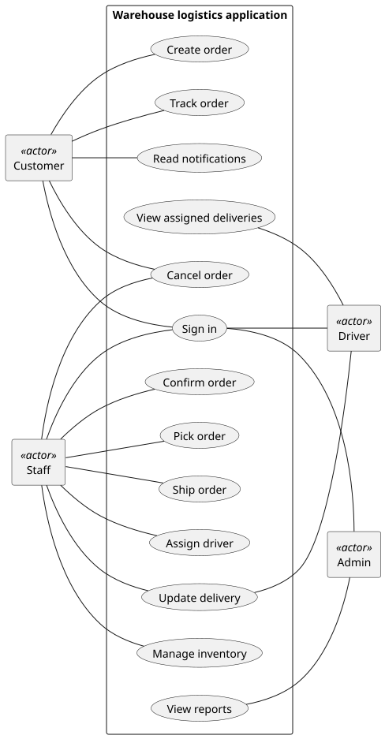
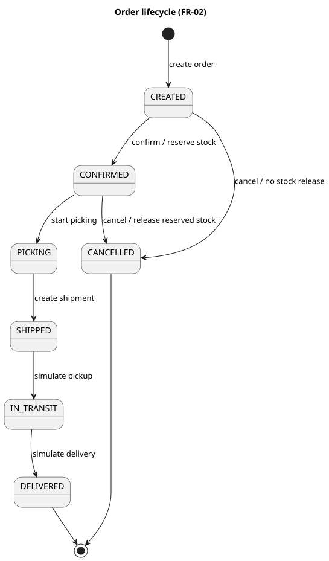
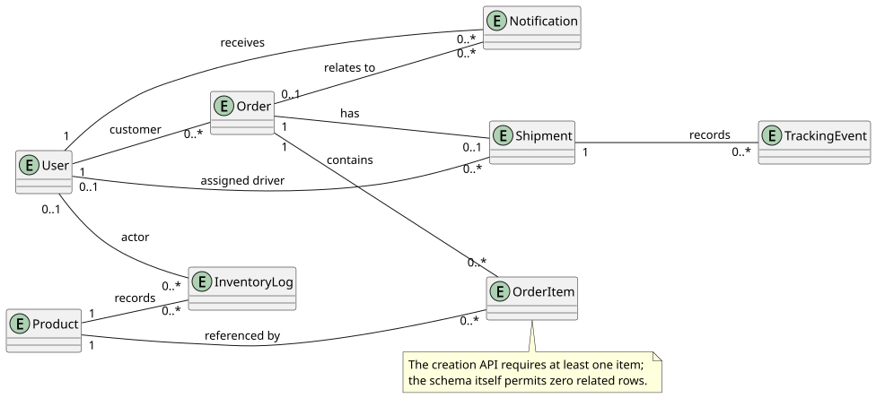
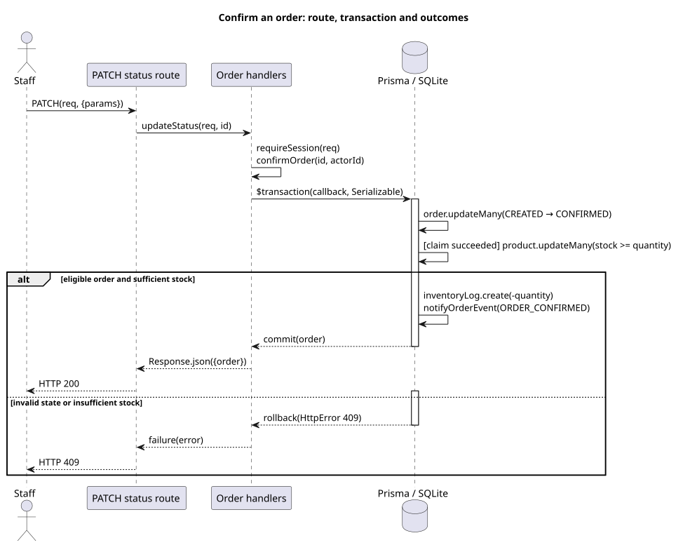
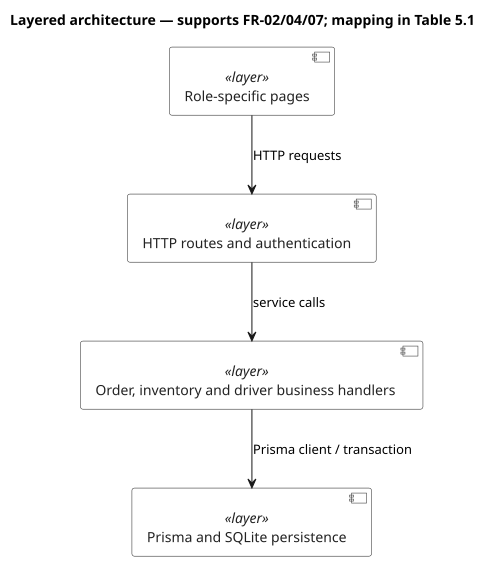

# COMP 3500SEF · Final Report

**Warehouse Logistics Management System**  
**Group 42:** Tang Yi Jie, Yin Pei Xu, Tang Chao, Yang Ting Zhang, Wu Peng Bo, Chung Ngon Man, Li Mu Qiu.  
**Testing:** Chung Ngon Man, Li Mu Qiu.

## 1. Scope

Goals: traceable decisions, role-separated workflows. Roles: customer, staff, driver, administrator. Local-only: one app; seed data only (RK-05/10, Table B).

## 2. Development process

**Table A. Increments**

| Increment and date | Trigger / activity | Outcome |
|---|---|---|
| Planning, 9–11 Oct 2026 | Coursework kickoff | Scope, roles, API contracts ([register](https://github.com/Et1enneee/comp3500-logistics/blob/main/logistics/docs/process/increments.md)) |
| 17 Oct review | Requirements review | Two defects found; fixed in row 3 |
| Confirmation, 26–28 Oct 2026 | Row-2 defects: repeat submits, no stock ledger | Both fixed — transaction verified ([orders tests](https://github.com/Et1enneee/comp3500-logistics/blob/main/logistics/tests/orders.integration.ts)) |
| Integrated application, 1 Nov 2026 | Role functions integrated | Customer, staff, admin workflows end-to-end |
| Driver and privacy, 2 Nov 2026 | Driver, privacy tests missing | Both pass ([driver](https://github.com/Et1enneee/comp3500-logistics/blob/main/logistics/tests/driver.integration.ts), [privacy](https://github.com/Et1enneee/comp3500-logistics/blob/main/logistics/tests/privacy.integration.ts)) |
| Diagram review, 10–11 Nov 2026 | Diagrams diverged from code | Aligned ([review record](https://github.com/Et1enneee/comp3500-logistics/blob/main/logistics/docs/diagrams/compliance.md)) |
| Export simplification, 11 Nov 2026 | Export took four interactions ([issue #15](https://github.com/Et1enneee/comp3500-logistics/issues/15)) | Selected-date export in three interactions — two fills, one click |
| CI health tests, 11–12 Nov 2026 | No test covered CI-run outcomes | Two regression tests; unit suite 38 ([unit.log](https://github.com/Et1enneee/comp3500-logistics/blob/main/logistics/evidence/test-logs/2026-11-12-regression/unit.log)) |

## 3. Requirements

- FR-01 create orders with line items [Test](https://github.com/Et1enneee/comp3500-logistics/blob/main/logistics/tests/foundation.integration.ts).
- FR-02 enforce lifecycle, stock release [Test](https://github.com/Et1enneee/comp3500-logistics/blob/main/logistics/tests/orders.integration.ts) ([cancel](https://github.com/Et1enneee/comp3500-logistics/blob/main/logistics/tests/cancel.integration.ts)).
- FR-03 number orders, shipments; record the owning user [Test](https://github.com/Et1enneee/comp3500-logistics/blob/main/logistics/tests/logistics-chain.integration.ts).
- FR-04 inventory, ledger, low-stock alerts [Test](https://github.com/Et1enneee/comp3500-logistics/blob/main/logistics/tests/inventory.integration.ts).
- FR-05 record, read notifications [Test](https://github.com/Et1enneee/comp3500-logistics/blob/main/logistics/tests/notifications.integration.ts).
- FR-06 admin aggregates, CSV [Test](https://github.com/Et1enneee/comp3500-logistics/blob/main/logistics/tests/reports.integration.ts).
- FR-07 authenticate, access [Test](https://github.com/Et1enneee/comp3500-logistics/blob/main/logistics/tests/auth.integration.ts).
- FR-08 assign, deliver [Test](https://github.com/Et1enneee/comp3500-logistics/blob/main/logistics/tests/driver.integration.ts).

- NFR-01 API p95 ≤2 s, first contentful paint p95 ≤3 s on the local host ([measurement](https://github.com/Et1enneee/comp3500-logistics/blob/main/logistics/evidence/performance.json)).
- NFR-02 CI health — every commit ends in green unit, integration, browser runs ([runs](https://github.com/Et1enneee/comp3500-logistics/actions), [ci.yml](https://github.com/Et1enneee/comp3500-logistics/blob/main/.github/workflows/ci.yml), [browser log](https://github.com/Et1enneee/comp3500-logistics/blob/main/logistics/evidence/test-logs/2026-11-11-browser/browser.log)).
- NFR-03 least privilege: role gates; delivery address only to the assigned driver ([privacy tests](https://github.com/Et1enneee/comp3500-logistics/blob/main/logistics/tests/privacy.integration.ts)).
- NFR-04 interaction budget: every core operation (the eleven in §8) takes ≤3 in-app interactions (one interaction = one fill, selection or click; navigation excluded) ([walkthrough](https://github.com/Et1enneee/comp3500-logistics/blob/main/logistics/evidence/walkthrough/automated-walkthrough.md)).
- NFR-05 process quality — every increment closes on a recorded review or test run.

**Table B. Risk coverage** (RK = risk IDs, [risks.md](https://github.com/Et1enneee/comp3500-logistics/blob/main/logistics/docs/process/risks.md))

| Risk | Addressed by | Evidence |
|---|---|---|
| ①RK-01/03/06/08 schedules, test week, coursework squeeze, video deadlines | weekly re-planning, scope priorities | [risk plan](https://github.com/Et1enneee/comp3500-logistics/blob/main/logistics/docs/process/risks.md) |
| ②RK-02 contract rework | lifecycle defined once in [constants](https://github.com/Et1enneee/comp3500-logistics/blob/main/logistics/lib/constants.ts), asserted by tests | [constants tests](https://github.com/Et1enneee/comp3500-logistics/blob/main/logistics/lib/constants.test.ts) |
| ③RK-04/07 setup, stack | setup guide; CI per commit | [README](https://github.com/Et1enneee/comp3500-logistics/blob/main/logistics/README.md) [ci.yml](https://github.com/Et1enneee/comp3500-logistics/blob/main/.github/workflows/ci.yml) |
| ④RK-05 demo data | deterministic seed, regression-tested | [seed test](https://github.com/Et1enneee/comp3500-logistics/blob/main/logistics/tests/seed.integration.ts) |
| ⑤RK-09/10 hosting; personal data | team decision, 9 Oct — seed data only, no real personal data; NFR-03 governs in-app access | §1; [risk plan](https://github.com/Et1enneee/comp3500-logistics/blob/main/logistics/docs/process/risks.md) |

## 4. System models

Layers: pages, routes, handlers, Prisma/SQLite. **Order items** reference one product; orders belong to one user; an order has at most one shipment; products accumulate movements (InventoryLog).

*Figure 1. Thirteen use cases under four roles.*

*Figure 2. Order transitions: which reserve stock, which release it, which leave it unchanged.*

*Figure 3. Entities: User, Order, OrderItem, Product, Shipment, TrackingEvent, InventoryLog, Notification.*

*Figure 4. Confirmation: authenticated session, stock-checked writes, rollback.*

*Figure 5. These four layers, pages to persistence.*

## 5. Implementation

Stock is reserved at CONFIRMED, released on cancellation; lifecycle CREATED→CONFIRMED→PICKING→SHIPPED→IN_TRANSIT→DELIVERED.

Cancellation permissions:

| Role | Transition and effect |
|---|---|
| Customer | CREATED: cancel, no restock |
| Customer | CONFIRMED: cancel, restock |
| Staff | CREATED: rejected |
| Staff | CONFIRMED: cancel, restock |
| Customer, staff | PICKING onwards: rejected |

A CREATED order leaves CREATED only by customer cancel or staff confirmation.

Atomic confirmation (HTTP 409 on repeats; rollback on short stock); driverId set at SHIPPED, immutable after; FR-03/04 verified ([order-api](https://github.com/Et1enneee/comp3500-logistics/blob/main/logistics/lib/order-api.ts#L245), [driver-api](https://github.com/Et1enneee/comp3500-logistics/blob/main/logistics/lib/driver-api.ts#L44), [inventory-api](https://github.com/Et1enneee/comp3500-logistics/blob/main/logistics/lib/inventory-api.ts#L142)).

## 6. Verification

Verification checks the implementation against §3; validation exercises the delivered workflows (§8). [CI](https://github.com/Et1enneee/comp3500-logistics/actions/runs/43175733067) records 38 unit, 140 integration, 2 integrity: the demo-data reset requires RESET_DEMO_DATA=YES (so evidence runs cannot wipe seeded state), and CI compares the packaged submission's SHA-256 manifest with the source ([integrity checks](https://github.com/Et1enneee/comp3500-logistics/blob/main/logistics/tests/integrity.check.mjs)). Browser acceptance runs on every commit; latest 26 checks (11 Nov) ([browser log](https://github.com/Et1enneee/comp3500-logistics/blob/main/logistics/evidence/test-logs/2026-11-11-browser/browser.log)). Logs: [integration](https://github.com/Et1enneee/comp3500-logistics/blob/main/logistics/evidence/test-logs/2026-11-12-regression/integration.log) "tests 140", "pass 140"; [unit](https://github.com/Et1enneee/comp3500-logistics/blob/main/logistics/evidence/test-logs/2026-11-12-regression/unit.log) "Tests 38 passed (38)".

Loopback [measurement](https://github.com/Et1enneee/comp3500-logistics/blob/main/logistics/evidence/performance.json): p95 3.2–13.6 ms, first contentful paint p95 64–96 ms (30 samples per endpoint) vs the 2 s / 3 s budgets — not representative of public networks.

Reviews verified requirements and models statically; the export fix was validated via the interface (§8).

## 7. Evolution

Reviews: 17 Oct found two defects fixed by confirmation (§5); 10–11 Nov aligned diagrams; NFR-01 hosted → local; NFR-02 window → per-commit CI green (§3). Feedback that CI outcomes were untested led to two regression tests (row 8; unit suite 36→38, 36 = count before).

## 8. Validation

[Walkthrough](https://github.com/Et1enneee/comp3500-logistics/blob/main/logistics/evidence/walkthrough/automated-walkthrough.md) covers eleven operations: create order; open details; confirm; start picking; ship; assign driver; record pickup; record delivery; filter report; export current; export selected dates — ≤3 interactions each; the 26 checks reach Figure 1's thirteen use cases ([coverage map](https://github.com/Et1enneee/comp3500-logistics/blob/main/logistics/evidence/walkthrough/coverage-map.md)). "Browser acceptance passed: 26 checks" ([browser log](https://github.com/Et1enneee/comp3500-logistics/blob/main/logistics/evidence/test-logs/2026-11-11-browser/browser.log)): 20 checks (five operations once, three twice, three thrice) plus 6 cross-cutting checks — validation, session, interface: two each. During report preparation, both testers (Chung Ngon Man, Li Mu Qiu) made 64 unaided attempts (32 each, repeated across the six core tasks); median 2.1 min per session ([user-validation](https://github.com/Et1enneee/comp3500-logistics/blob/main/logistics/evidence/user-validation.md)).

## 9. Feedback and reconciliation

**Sources:** whole-team reviews (all seven members); test runs and the scripted walkthrough executed by Chung Ngon Man and Li Mu Qiu.

**Table C. Feedback**

| Feedback (source, date) | Disposition and evidence |
|---|---|
| Stock effects under FR-04 (17 Oct, [traceability](https://github.com/Et1enneee/comp3500-logistics/blob/main/logistics/docs/traceability.md)) | Moved to FR-02 |
| Thin trigger descriptions (10–11 Nov, [register](https://github.com/Et1enneee/comp3500-logistics/blob/main/logistics/docs/process/increments.md)) | Rewritten (Table A) |
| Filter-then-export took four interactions (11 Nov, [issue #15](https://github.com/Et1enneee/comp3500-logistics/issues/15)) | Combined path proposed and rejected (steps already totalled four); the direct path meets NFR-04 (row 7); tracked in issue #15 |
| No CI-health test (11 Nov, [unit.log](https://github.com/Et1enneee/comp3500-logistics/blob/main/logistics/evidence/test-logs/2026-11-12-regression/unit.log)) | Two regression tests (row 8); suite 38 |
| NFR-01/02 assumed hosted measurement, daily window (10–11 Nov, [revision log](https://github.com/Et1enneee/comp3500-logistics/blob/main/logistics/docs/requirements/srs.md#7-document-control)) | NFR-01 "hosted, daily window" → "on the local host"; NFR-02 "daily window" → "per-commit CI green" |

## 10. Evidence

38 unit (row 8's two included), 140 integration, 2 integrity (12 Nov); 26 browser checks (11 Nov) ([history](https://github.com/Et1enneee/comp3500-logistics/commits/main)) — [BASELINE](https://github.com/Et1enneee/comp3500-logistics/blob/main/logistics/BASELINE-final-report.json) (final CI snapshot). [Traceability](https://github.com/Et1enneee/comp3500-logistics/blob/main/logistics/docs/traceability.md). Limits: local-only, seed data, in-team validation (§1, §8).
