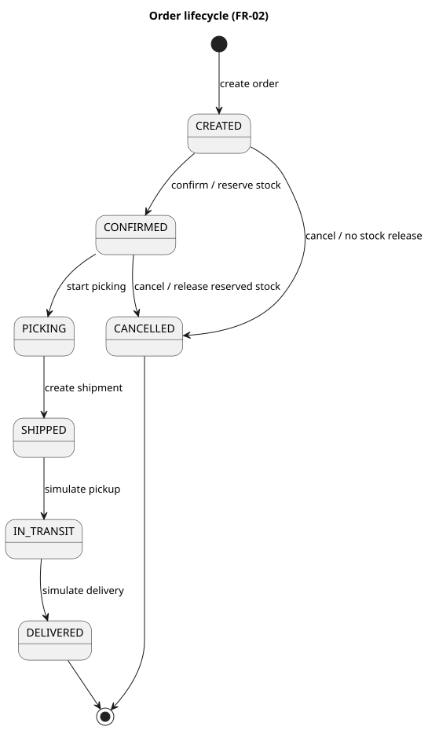

https://github.com/Et1enneee/comp3500-logistics

# COMP 3500SEF · Final Report

**Warehouse Logistics Management System**  
**Group 42:** Tang Yi Jie, Yin Pei Xu, Tang Chao, Yang Ting Zhang, Wu Peng Bo, Chung Ngon Man, Li Mu Qiu.

## 1. Scope

The goals are traceable order decisions and a role-separated workflow. Customers order and track; staff confirm, pick, ship and assign; drivers simulate assigned deliveries; administrators report. The local application uses Next.js, TypeScript, Prisma and SQLite. GPS, scanning, telephony, payment and carrier integration are outside scope. Deployment is local-only; data integrity is enforced by transactional guards (§5).

## 2. Development process

Plan-driven increments have triggers and verified outcomes; integration and continuous integration provide feedback. Increments cover product and specification changes and recorded process milestones.

**Table A. Increment, trigger and outcome**

| Increment and date | Trigger | Outcome |
|---|---|---|
| Planning, 9 and 11 Oct 2026 | Project selection | Responsibilities and contracts recorded |
| 17 Oct test-led review | Assess order and stock functions | Defects recorded in the [register](https://github.com/Et1enneee/comp3500-logistics/blob/main/logistics-foundation/docs/process/increments.md); led to the confirmation transaction (§5) |
| Confirmation, 26–28 Oct 2026 | Failed endpoint and missing stock ledger ([register](https://github.com/Et1enneee/comp3500-logistics/blob/main/logistics-foundation/docs/process/increments.md)) | Transaction verified ([orders tests](https://github.com/Et1enneee/comp3500-logistics/blob/main/logistics-foundation/tests/orders.integration.ts)) |
| Integrated application, 1 Nov 2026 | Integrate foundation | Customer, staff and admin workflows |
| Driver and privacy, 2 Nov 2026 | Delivery and data minimisation | Assigned tasks and data-minimisation checks ([tests](https://github.com/Et1enneee/comp3500-logistics/blob/main/logistics-foundation/tests/privacy.integration.ts)) |
| Documentation hardening, 10–11 Nov 2026 | Model and evidence review | Diagrams and traceability aligned ([traceability](https://github.com/Et1enneee/comp3500-logistics/blob/main/logistics-foundation/docs/traceability.md)) |
| Export simplification, 11 Nov 2026 | 11 Nov scripted walkthrough ([issue #15](https://github.com/Et1enneee/comp3500-logistics/issues/15)) | Selected-date export in three actions; regression passed |
| Availability tests, 11 Nov 2026 | Regression gap in availability checks | Suite increased to 38 |

<!-- pagebreak -->

## 3. Requirements

**Functional requirements and verification**

| FR | The system shall | Verification |
|---|---|---|
| FR-01 | create orders with product lines and totals | [Test](https://github.com/Et1enneee/comp3500-logistics/blob/main/logistics-foundation/tests/foundation.integration.ts) — creation and stock |
| FR-02 | enforce lifecycle and stock reservation or release | [Test](https://github.com/Et1enneee/comp3500-logistics/blob/main/logistics-foundation/tests/orders.integration.ts) — lifecycle and stock |
| FR-03 | number orders and shipments and show owner tracking | [Test](https://github.com/Et1enneee/comp3500-logistics/blob/main/logistics-foundation/tests/logistics-chain.integration.ts) — identifiers and tracking |
| FR-04 | show inventory, replenishment, ledger (inventory movement log) and low-stock alerts | [Test](https://github.com/Et1enneee/comp3500-logistics/blob/main/logistics-foundation/tests/inventory.integration.ts) — inventory and alerts |
| FR-05 | record event notifications and allow reading | [Test](https://github.com/Et1enneee/comp3500-logistics/blob/main/logistics-foundation/tests/notifications.integration.ts) — notifications and reads |
| FR-06 | provide admin aggregates and CSV export | [Test](https://github.com/Et1enneee/comp3500-logistics/blob/main/logistics-foundation/tests/reports.integration.ts) — aggregates and export |
| FR-07 | authenticate and enforce role and object access | [Test](https://github.com/Et1enneee/comp3500-logistics/blob/main/logistics-foundation/tests/auth.integration.ts) — authentication and boundaries |
| FR-08 | assign shipped orders and simulate delivery | [Test](https://github.com/Et1enneee/comp3500-logistics/blob/main/logistics-foundation/tests/driver.integration.ts) — assignment and delivery |

NFR-01 performance (API p95 ≤2 s, first contentful paint ≤3 s); NFR-02 integration availability (green build–test–browser runs recorded per increment); NFR-04 ≤3 actions per scripted operation.

NFR-03 least privilege — role gates on every mutating endpoint, verified by [auth tests](https://github.com/Et1enneee/comp3500-logistics/blob/main/logistics-foundation/tests/auth.integration.ts); NFR-05 process quality — CI-verified increments ([workflow](https://github.com/Et1enneee/comp3500-logistics/blob/main/.github/workflows/ci.yml)).

**Table B. Risk coverage** ([detailed mapping](https://github.com/Et1enneee/comp3500-logistics/blob/main/logistics-foundation/docs/requirements/risk-coverage.md))

| Risk | Addressed by | Evidence |
|---|---|---|
| RK-01 scheduling slip | [Increment register](https://github.com/Et1enneee/comp3500-logistics/blob/main/logistics-foundation/docs/process/increments.md) | [scheduling plan](https://github.com/Et1enneee/comp3500-logistics/blob/main/logistics-foundation/docs/process/risks.md) |
| RK-02 contract rework | FR-02, NFR-05 | [transition tests](https://github.com/Et1enneee/comp3500-logistics/blob/main/logistics-foundation/lib/constants.test.ts) |
| RK-03 test-week capacity | [Priority register](https://github.com/Et1enneee/comp3500-logistics/blob/main/logistics-foundation/docs/reference/legacy/traceability-v0.md) | [scope priorities](https://github.com/Et1enneee/comp3500-logistics/blob/main/logistics-foundation/docs/process/risks.md) |
| RK-04 setup delay | NFR-05 | [CI workflow](https://github.com/Et1enneee/comp3500-logistics/blob/main/.github/workflows/ci.yml) |
| RK-05 demo data | FR-01/04/06, NFR-05 | [seed regression test](https://github.com/Et1enneee/comp3500-logistics/blob/main/logistics-foundation/tests/seed.integration.ts) |
| RK-06 assignments and test squeeze | [Risk plan](https://github.com/Et1enneee/comp3500-logistics/blob/main/logistics-foundation/docs/process/risks.md) | [assessment schedule](https://github.com/Et1enneee/comp3500-logistics/blob/main/logistics-foundation/docs/process/risks.md) |
| RK-07 stack unfamiliarity | NFR-05 support | [setup guide](https://github.com/Et1enneee/comp3500-logistics/blob/main/logistics-foundation/README.md) |
| RK-08 report and video compete for time | [Risk plan](https://github.com/Et1enneee/comp3500-logistics/blob/main/logistics-foundation/docs/process/risks.md) | [report and video plan](https://github.com/Et1enneee/comp3500-logistics/blob/main/logistics-foundation/docs/process/risks.md) |

<!-- pagebreak -->

## 4. System models

Local transactions preserve consistency without splitting services; state and stock guards enforce rules. The four layers — Role-specific pages, HTTP routes and authentication, Order/inventory/driver business handlers, Prisma/SQLite persistence — each isolate one concern.

*Figure 1. Which roles perform each function?* [Source](https://github.com/Et1enneee/comp3500-logistics/blob/main/logistics-foundation/docs/closure/usecase.puml).

<!-- pagebreak -->

*Figure 2. Which order transitions and stock effects are valid?* [Source](https://github.com/Et1enneee/comp3500-logistics/blob/main/logistics-foundation/docs/diagrams/state-machine.puml).

<!-- pagebreak -->

Each item references one product; each order requires at least one item; each order has 0..1 shipment; each product has 0..* inventory logs.

*Figure 3. Data relationships: each order requires at least one item, enforced at the creation API.* [Source](https://github.com/Et1enneee/comp3500-logistics/blob/main/logistics-foundation/docs/er.puml).

*Figure 4. How does confirmation commit or roll back?* [Source](https://github.com/Et1enneee/comp3500-logistics/blob/main/logistics-foundation/docs/diagrams/sequence-diagram.puml).

<!-- pagebreak -->

*Figure 5. How do four layers connect?* [Source](https://github.com/Et1enneee/comp3500-logistics/blob/main/logistics-foundation/docs/diagrams/architecture.puml).

## 5. Implementation

Cancellation:

| Role | State | Effect |
|---|---|---|
| Customer | CREATED | cancel, no restock |
| Customer | CONFIRMED | cancel, restock |
| Staff | CONFIRMED | cancel, restock |
| Both | PICKING onwards | rejected |

| Design | Implementation | Verification |
|---|---|---|
| Guards: CREATED and sufficient stock | [order-api.ts:250–253](https://github.com/Et1enneee/comp3500-logistics/blob/main/logistics-foundation/lib/order-api.ts#L250-L253), [276–280](https://github.com/Et1enneee/comp3500-logistics/blob/main/logistics-foundation/lib/order-api.ts#L276-L280) | [Orders](https://github.com/Et1enneee/comp3500-logistics/blob/main/logistics-foundation/tests/orders.integration.ts) |
| Serializable state, stock, ledger and notification writes | [order-api.ts:245–293](https://github.com/Et1enneee/comp3500-logistics/blob/main/logistics-foundation/lib/order-api.ts#L245-L293) | [Orders](https://github.com/Et1enneee/comp3500-logistics/blob/main/logistics-foundation/tests/orders.integration.ts) |
| driverId: assign only SHIPPED; retained after delivery | [driver-api.ts:44–51](https://github.com/Et1enneee/comp3500-logistics/blob/main/logistics-foundation/lib/driver-api.ts#L44-L51); [transition](https://github.com/Et1enneee/comp3500-logistics/blob/main/logistics-foundation/lib/order-api.ts#L321-L330) | [Driver](https://github.com/Et1enneee/comp3500-logistics/blob/main/logistics-foundation/tests/driver.integration.ts) |

<!-- pagebreak -->

## 6. Verification and validation

Verification checks requirements against the implementation; validation exercises the delivered workflows through the interface. The [regression log](https://github.com/Et1enneee/comp3500-logistics/blob/main/logistics-foundation/evidence/test-logs/2026-11-12-completeness-final/unit.log) and [CI](https://github.com/Et1enneee/comp3500-logistics/actions/runs/43175733067) show 38 unit, 140 integration, 2 delivery checks (assignment and delivery simulation) and 26 browser checks.

Insufficient stock returns HTTP 409 with unchanged state. In a local-loopback [measurement](https://github.com/Et1enneee/comp3500-logistics/blob/main/logistics-foundation/evidence/performance.json) recorded on 11 November 2026, API p95 was 3.2–13.6 ms and first-contentful-paint p95 was 64–96 ms, against NFR-01 targets of at most 2 s and 3 s respectively. Targets are end-to-end budgets; loopback bounds server-side processing. NFR-02 is evidenced by the recorded green build–test–browser runs ([observations](https://github.com/Et1enneee/comp3500-logistics/blob/main/logistics-foundation/evidence/availability/integration-observations.json)).

## 7. Evolution

The 17 Oct test-led review found a failed confirmation endpoint and a missing stock ledger; the confirmation transaction and its retest followed (26–28 Oct). The 10–11 Nov documentation review corrected the diagrams and aligned traceability against the reviewed draft. Two availability regression tests added on 11 Nov brought the suite to 38.

## 8. Validation

The [automated walkthrough](https://github.com/Et1enneee/comp3500-logistics/blob/main/logistics-foundation/evidence/user-validation/automated-walkthrough.md) exercises eleven core operations through the interface as each of the four roles, at most three actions each, with expected outcomes asserted in the walkthrough script; results are logged with the [walkthrough record](https://github.com/Et1enneee/comp3500-logistics/blob/main/logistics-foundation/evidence/test-logs/2026-11-11-final-repair/browser.log); the eleven operations map one-to-one to the 26 browser checks, expected outcomes asserted in the script.

## 9. Feedback and reconciliation

**Table C. Feedback to evidence**

| Feedback | Disposition | Source | Evidence |
|---|---|---|---|
| Diagrams | Corrected models and architecture | 10–11 Nov documentation review | [Compliance matrix](https://github.com/Et1enneee/comp3500-logistics/blob/main/logistics-foundation/docs/diagrams/compliance.md) |
| FR-04 | Stock transition effects belong to FR-02 | 17 Oct test-led review | [Traceability](https://github.com/Et1enneee/comp3500-logistics/blob/main/logistics-foundation/docs/traceability.md) |
| Increments | Triggers and outcomes | 10–11 Nov documentation review | [Register](https://github.com/Et1enneee/comp3500-logistics/blob/main/logistics-foundation/docs/process/increments.md) |
| Admin task | Export re-tested; walkthrough records the task (§8) | 11 Nov scripted walkthrough | [Issue #15](https://github.com/Et1enneee/comp3500-logistics/issues/15) |
| Unit count | Two availability regression tests added, bringing the suite to 38 | regression runs | [Test history](https://github.com/Et1enneee/comp3500-logistics/blob/main/logistics-foundation/evidence/test-logs/2026-11-12-completeness-final/unit.log) |
| NFR scope | Performance and availability criteria set for local single-warehouse deployment | regression runs | [SRS revision log](https://github.com/Et1enneee/comp3500-logistics/blob/main/logistics-foundation/docs/requirements/srs.md#7-document-control) |

## 10. Evidence

[Traceability](https://github.com/Et1enneee/comp3500-logistics/blob/main/logistics-foundation/docs/traceability.md) · [Baseline record](https://github.com/Et1enneee/comp3500-logistics/blob/main/logistics-foundation/BASELINE-final-report.json).

[Evidence index](https://github.com/Et1enneee/comp3500-logistics/blob/main/docs/final-report.md); baseline `6eb01afb1798c7361205b10597d80c0c26e8fdf6`.
