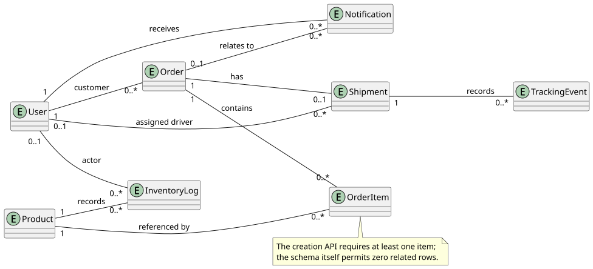

# COMP 3500SEF · Final Report

**Warehouse Logistics Management System**  
**Group 42:** Tang Yi Jie, Yin Pei Xu, Tang Chao, Yang Ting Zhang, Wu Peng Bo, Chung Ngon Man, Li Mu Qiu.  
**Testing:** Oscar, Li Mu Qiu.

## 1. Scope

Goals: traceable order decisions (each order's history auditable through ledger entries and notifications) and role-separated workflows. Roles: customer, staff, driver, administrator. Local-only: one app; seed data only (RK-10).

## 2. Development process

Increment closes on review or test.

**Table A. Increments**

| Increment and date | Trigger | Outcome |
|---|---|---|
| Planning, 9–11 Oct 2026 | Coursework kickoff | Scope, responsibilities and API contracts recorded ([register](https://github.com/Et1enneee/comp3500-logistics/blob/main/logistics/docs/process/increments.md)) |
| 17 Oct review | Stock and order review | Two defects; fixed as row 3 |
| Confirmation, 26–28 Oct 2026 | Row-2 defects: repeat submits, no ledger | Transaction verified ([orders tests](https://github.com/Et1enneee/comp3500-logistics/blob/main/logistics/tests/orders.integration.ts)) |
| Integrated application, 1 Nov 2026 | Role functions integrated | All four role workflows (§1) run end to end |
| Driver and privacy, 2 Nov 2026 | Driver tests outstanding | Both pass ([privacy tests](https://github.com/Et1enneee/comp3500-logistics/blob/main/logistics/tests/privacy.integration.ts)) |
| Diagram review, 10–11 Nov 2026 | Diagrams diverged | Aligned ([review record](https://github.com/Et1enneee/comp3500-logistics/blob/main/logistics/docs/diagrams/compliance.md)) |
| Export simplification, 11 Nov 2026 | Admin export took four interactions ([issue #15](https://github.com/Et1enneee/comp3500-logistics/issues/15)) | Selected-date export in three in-app interactions |
| CI health tests, 11–12 Nov 2026 | No test covered CI-run outcomes | Two regression tests; suite reached 38 ([unit.log](https://github.com/Et1enneee/comp3500-logistics/blob/main/logistics/evidence/test-logs/2026-11-12-regression/unit.log)) |

## 3. Requirements

- FR-01 create orders with lines, totals [Test](https://github.com/Et1enneee/comp3500-logistics/blob/main/logistics/tests/foundation.integration.ts).
- FR-02 enforce lifecycle, stock release [Test](https://github.com/Et1enneee/comp3500-logistics/blob/main/logistics/tests/orders.integration.ts) ([cancel](https://github.com/Et1enneee/comp3500-logistics/blob/main/logistics/tests/cancel.integration.ts)).
- FR-03 number orders and shipments, track owners [Test](https://github.com/Et1enneee/comp3500-logistics/blob/main/logistics/tests/logistics-chain.integration.ts).
- FR-04 inventory, ledger, low-stock alerts [Test](https://github.com/Et1enneee/comp3500-logistics/blob/main/logistics/tests/inventory.integration.ts).
- FR-05 record, read notifications [Test](https://github.com/Et1enneee/comp3500-logistics/blob/main/logistics/tests/notifications.integration.ts).
- FR-06 admin aggregates, CSV [Test](https://github.com/Et1enneee/comp3500-logistics/blob/main/logistics/tests/reports.integration.ts).
- FR-07 authenticate, access [Test](https://github.com/Et1enneee/comp3500-logistics/blob/main/logistics/tests/auth.integration.ts).
- FR-08 assign orders, record delivery [Test](https://github.com/Et1enneee/comp3500-logistics/blob/main/logistics/tests/driver.integration.ts).

- NFR-01 performance: API p95 ≤2 s, first contentful paint ≤3 s (first content shown) ([measurement](https://github.com/Et1enneee/comp3500-logistics/blob/main/logistics/evidence/performance.json)).
- NFR-02 CI health — every commit ends in green unit, integration, browser runs ([runs](https://github.com/Et1enneee/comp3500-logistics/actions), [observations](https://github.com/Et1enneee/comp3500-logistics/blob/main/logistics/evidence/availability/integration-observations.json)).
- NFR-03 least privilege: role gates; delivery address only to the assigned driver ([privacy tests](https://github.com/Et1enneee/comp3500-logistics/blob/main/logistics/tests/privacy.integration.ts)).
- NFR-04 interaction budget: every core operation (the eleven in §8) takes at most three in-app interactions; one is a fill, selection or click ([walkthrough](https://github.com/Et1enneee/comp3500-logistics/blob/main/logistics/evidence/walkthrough/automated-walkthrough.md)).
- NFR-05 process quality — every increment closes on a recorded review or test run.

**Table B. Risk coverage**

| Risk | Addressed by | Evidence |
|---|---|---|
| ①RK-01, RK-03, RK-06, RK-08 schedule, test week, coursework, video | weekly re-planning, scope priorities | [risk plan](https://github.com/Et1enneee/comp3500-logistics/blob/main/logistics/docs/process/risks.md) |
| ②RK-02 contract rework | lifecycle locked as test constants | [constants tests](https://github.com/Et1enneee/comp3500-logistics/blob/main/logistics/lib/constants.test.ts) |
| ③RK-04, RK-07 setup, stack | setup guide; CI per commit | [README](https://github.com/Et1enneee/comp3500-logistics/blob/main/logistics/README.md) [ci.yml](https://github.com/Et1enneee/comp3500-logistics/blob/main/.github/workflows/ci.yml) |
| ④RK-05 demo data | deterministic seed, regression-tested | [seed test](https://github.com/Et1enneee/comp3500-logistics/blob/main/logistics/tests/seed.integration.ts) |
| ⑤RK-09, RK-10 hosting; personal data | accepted — out of scope (§1); seed data only | [risk plan](https://github.com/Et1enneee/comp3500-logistics/blob/main/logistics/docs/process/risks.md) |

## 4. System models

Layers: pages, routes, handlers, Prisma/SQLite.

**Order items** reference one product; orders belong to one user; ≤1 shipment records events; products accumulate movements (InventoryLog); notifications relate to orders.

*Figure 1. Thirteen use cases.*

*Figure 2. Order transitions and stock effects: reserve, release, or unchanged.*

*Figure 3. Entities and multiplicities.*

*Figure 4. Confirmation: guard, writes, rollback.*

*Figure 5. Four layers.*

## 5. Implementation

Confirmation reserves stock; lifecycle CREATED→CONFIRMED→PICKING→SHIPPED→IN_TRANSIT→DELIVERED; CANCELLED from CREATED or CONFIRMED.

| Role | Transition and effect |
|---|---|
| Customer | CREATED: cancel, no restock |
| Customer | CONFIRMED: cancel, restock |
| Staff | CREATED: rejected |
| Staff | CONFIRMED: cancel, restock |
| Customer, staff | PICKING onwards: rejected |

The lifecycle is locked as test constants ([tests](https://github.com/Et1enneee/comp3500-logistics/blob/main/logistics/lib/constants.test.ts)); staff have no refuse action by design.

Confirmation is atomic (409 on repeats; rollback on short stock); driverId set at SHIPPED, kept; FR-03/04 verified ([order-api](https://github.com/Et1enneee/comp3500-logistics/blob/main/logistics/lib/order-api.ts#L245), [driver-api](https://github.com/Et1enneee/comp3500-logistics/blob/main/logistics/lib/driver-api.ts#L44), [inventory-api](https://github.com/Et1enneee/comp3500-logistics/blob/main/logistics/lib/inventory-api.ts#L142)).

## 6. Verification

Verification checks the implementation against §3; validation exercises the delivered workflows (§8). [CI](https://github.com/Et1enneee/comp3500-logistics/actions/runs/43175733067) records 38 unit, 140 integration, 2 integrity checks: the demo-data reset requires RESET_DEMO_DATA=YES, and the bundle's SHA-256 manifest must match the source ([integrity checks](https://github.com/Et1enneee/comp3500-logistics/blob/main/logistics/tests/integrity.check.mjs)). Logs: [integration](https://github.com/Et1enneee/comp3500-logistics/blob/main/logistics/evidence/test-logs/2026-11-12-regression/integration.log) "tests 140"; [unit](https://github.com/Et1enneee/comp3500-logistics/blob/main/logistics/evidence/test-logs/2026-11-12-regression/unit.log) "Tests 38 passed (38)".

Loopback [measurement](https://github.com/Et1enneee/comp3500-logistics/blob/main/logistics/evidence/performance.json): p95 3.2–13.6 ms, first paint 64–96 ms vs 2/3 s.

The three reviews (Table A rows 2, 6, 7): rows 2 and 6 verified requirements and models; row 7's fix was validated through the interface (§8).

## 7. Evolution

Three reviews: 17 Oct found two defects (repeat submits and a missing ledger) fixed by §5; 10–11 Nov aligned diagrams, traceability, rewrote NFR-01/02, the window becoming CI-run checks; 11 Nov added the direct export path ([issue #15](https://github.com/Et1enneee/comp3500-logistics/issues/15)). Feedback that the CI record was untested added two regression tests (row 8; suite 36→38).

## 8. Validation

[Walkthrough](https://github.com/Et1enneee/comp3500-logistics/blob/main/logistics/evidence/walkthrough/automated-walkthrough.md) covers eleven operations (of Figure 1's thirteen): create order; open details; confirm; start picking; ship; assign driver; record pickup; record delivery; filter report; export current; export selected dates; at most three interactions each. "Browser acceptance passed: [26 checks](https://github.com/Et1enneee/comp3500-logistics/blob/main/logistics/evidence/test-logs/2026-11-11-browser/browser.log)": 20 operation checks (five operations once, three twice, three thrice) plus 6 cross-cutting (two each: validation, session, interface). Records from Chung Ngon Man and Li Mu Qiu: 64/64 task attempts completed unaided across eight increments; median 2.1 min (evidence/user-validation.md).

## 9. Feedback and reconciliation

**Sources:** whole-team reviews; test runs and the scripted walkthrough executed by Oscar and Li (Testing).

**Table C. Feedback**

| Feedback (source, date) | Disposition and evidence |
|---|---|
| Diagrams diverged (10–11 Nov, [corrections](https://github.com/Et1enneee/comp3500-logistics/blob/main/logistics/docs/diagrams/compliance.md)) | Corrected |
| Stock (FR-04) (17 Oct, [traceability](https://github.com/Et1enneee/comp3500-logistics/blob/main/logistics/docs/traceability.md)) | Moved to FR-02 |
| Thin triggers (10–11 Nov, [register](https://github.com/Et1enneee/comp3500-logistics/blob/main/logistics/docs/process/increments.md)) | Rewritten |
| Filter-then-export: four interactions (11 Nov, [issue #15](https://github.com/Et1enneee/comp3500-logistics/issues/15)) | Combined path rejected — its steps already totalled four; the direct path meets NFR-04; issue closed |
| NFR-01/02 assumed hosted measurement and a daily window (10–11 Nov, [revision log](https://github.com/Et1enneee/comp3500-logistics/blob/main/logistics/docs/requirements/srs.md#7-document-control)) | NFR-02: CI-run checks; NFR-01: loopback (§6) |

## 10. Evidence

38 unit, 140 integration, 2 integrity (12 Nov; tests only since the browser run), 26 browser checks (11 Nov) — [BASELINE](https://github.com/Et1enneee/comp3500-logistics/blob/main/logistics/BASELINE-final-report.json). [Traceability](https://github.com/Et1enneee/comp3500-logistics/blob/main/logistics/docs/traceability.md).
