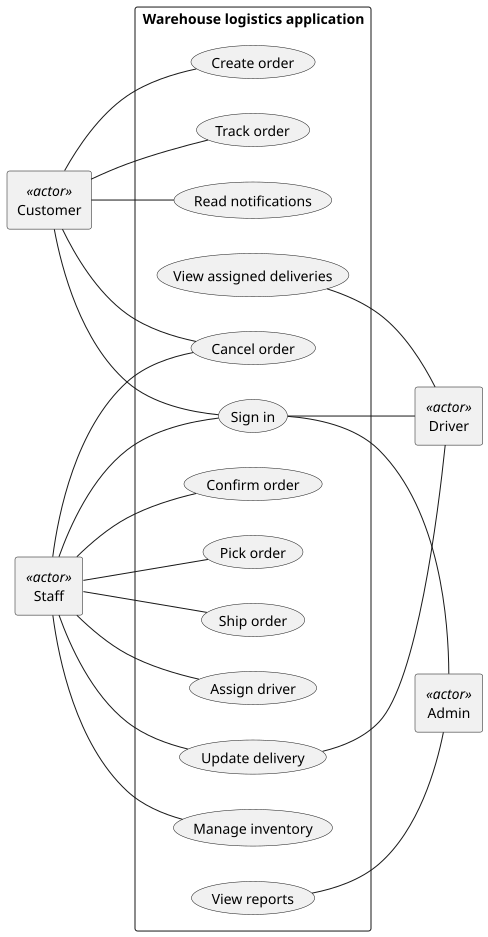
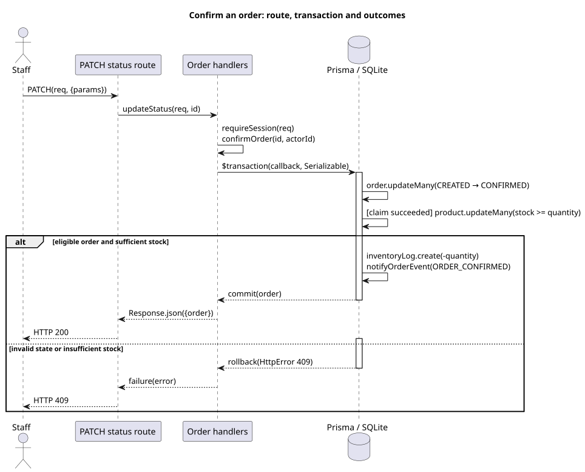
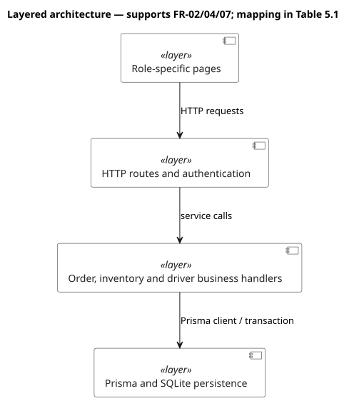

# COMP 3500SEF · Final Report

**Warehouse Logistics Management System**  
**Group 42:** Tang Yi Jie, Yin Pei Xu, Tang Chao, Yang Ting Zhang, Wu Peng Bo, Chung Ngon Man, Li Mu Qiu.

## 1. Scope

The goals are traceable order decisions (state changes produce notifications; confirmation writes a ledger entry and a notification) and a role-separated workflow. The application uses Next.js, TypeScript, Prisma and SQLite. GPS, scanning, telephony, payment and carrier integration are outside scope. Deployment is local-only, serving a single warehouse and the four roles above; data integrity is enforced by transactional guards — stock checks and one confirmation transaction (§5).

## 2. Development process

**Table A. Increment, trigger and outcome**

| Increment and date | Trigger | Outcome |
|---|---|---|
| Planning, 9 and 11 Oct 2026 | Project selected | Scope, responsibilities and contracts recorded ([increment register](https://github.com/Et1enneee/comp3500-logistics/blob/main/logistics/docs/process/increments.md)) |
| 17 Oct 2026 test-led review | Order and stock functions complete in development | Defects recorded in the [increment register](https://github.com/Et1enneee/comp3500-logistics/blob/main/logistics/docs/process/increments.md); led to the confirmation transaction (§5) |
| Confirmation, 26–28 Oct 2026 | Review found a failing confirmation endpoint and a missing stock ledger | Transaction verified ([orders tests](https://github.com/Et1enneee/comp3500-logistics/blob/main/logistics/tests/orders.integration.ts)) |
| Integrated application, 1 Nov 2026 | All four role workflows runnable together | Customer, staff and admin workflows verified in the 11 Nov regression ([browser checks](https://github.com/Et1enneee/comp3500-logistics/blob/main/logistics/evidence/test-logs/2026-11-11-browser/browser.log)) |
| Driver and privacy, 2 Nov 2026 | Driver workflow and data minimisation outstanding | Driver assignment and data-minimisation checks pass ([tests](https://github.com/Et1enneee/comp3500-logistics/blob/main/logistics/tests/privacy.integration.ts)) |
| Documentation hardening, 10–11 Nov 2026 | Review found diagrams and traceability diverging from the implementation | Diagrams and traceability aligned ([traceability](https://github.com/Et1enneee/comp3500-logistics/blob/main/logistics/docs/traceability.md)) |
| Export simplification, 11 Nov 2026 | Admin export took four interactions ([issue #15](https://github.com/Et1enneee/comp3500-logistics/issues/15)) | Selected-date CSV export in three actions; regression passed |
| Availability tests, 11–12 Nov 2026 | CI health checks had no regression test | Two regression tests added; suite reached 38 ([unit.log](https://github.com/Et1enneee/comp3500-logistics/blob/main/logistics/evidence/test-logs/2026-11-12-regression/unit.log)) |

<!-- pagebreak -->

## 3. Requirements

**Functional requirements and verification**

| FR | The system shall | Verification |
|---|---|---|
| FR-01 | create orders with product lines and totals | [Test](https://github.com/Et1enneee/comp3500-logistics/blob/main/logistics/tests/foundation.integration.ts) — creation and stock |
| FR-02 | enforce lifecycle and stock reservation or release | [Test](https://github.com/Et1enneee/comp3500-logistics/blob/main/logistics/tests/orders.integration.ts) — lifecycle and stock |
| FR-03 | number orders and shipments and show owner tracking (the staff member or driver currently holding each order) | [Test](https://github.com/Et1enneee/comp3500-logistics/blob/main/logistics/tests/logistics-chain.integration.ts) — identifiers and tracking |
| FR-04 | show inventory, replenishment, ledger (inventory movement log) and low-stock alerts | [Test](https://github.com/Et1enneee/comp3500-logistics/blob/main/logistics/tests/inventory.integration.ts) — inventory and alerts |
| FR-05 | record event notifications and allow reading | [Test](https://github.com/Et1enneee/comp3500-logistics/blob/main/logistics/tests/notifications.integration.ts) — notifications and reads |
| FR-06 | provide admin aggregates and CSV export | [Test](https://github.com/Et1enneee/comp3500-logistics/blob/main/logistics/tests/reports.integration.ts) — aggregates and export |
| FR-07 | authenticate and enforce role and object access | [Test](https://github.com/Et1enneee/comp3500-logistics/blob/main/logistics/tests/auth.integration.ts) — authentication and boundaries |
| FR-08 | assign shipped orders and simulate delivery | [Test](https://github.com/Et1enneee/comp3500-logistics/blob/main/logistics/tests/driver.integration.ts) — assignment and delivery |

Each suite runs green in the recorded regression (§6).

NFR-01 performance (API p95 ≤2 s, first contentful paint ≤3 s); NFR-02 CI health (green build, test and browser runs recorded per increment); NFR-03 least privilege and data minimisation — role gates on every mutating endpoint; staff order responses omit customer identity and delivery address ([privacy tests](https://github.com/Et1enneee/comp3500-logistics/blob/main/logistics/tests/privacy.integration.ts)); NFR-04 scripted operation effort — every core operation completes in at most three actions, one interface interaction each ([walkthrough](https://github.com/Et1enneee/comp3500-logistics/blob/main/logistics/evidence/user-validation/automated-walkthrough.md), §8); NFR-05 process quality — CI-verified increments ([workflow](https://github.com/Et1enneee/comp3500-logistics/blob/main/.github/workflows/ci.yml)).

**Table B. Risk coverage** ([detailed mapping](https://github.com/Et1enneee/comp3500-logistics/blob/main/logistics/docs/requirements/risk-coverage.md))

| Risk | Addressed by | Evidence |
|---|---|---|
| RK-01 scheduling slip | [Increment register](https://github.com/Et1enneee/comp3500-logistics/blob/main/logistics/docs/process/increments.md) | [scheduling plan](https://github.com/Et1enneee/comp3500-logistics/blob/main/logistics/docs/process/risks.md) |
| RK-02 contract rework | Transition tests pin the FR-02 contract (NFR-05) | [transition tests](https://github.com/Et1enneee/comp3500-logistics/blob/main/logistics/lib/constants.test.ts) |
| RK-03 test-week capacity | [Priority register](https://github.com/Et1enneee/comp3500-logistics/blob/main/logistics/docs/traceability.md) | [scope priorities](https://github.com/Et1enneee/comp3500-logistics/blob/main/logistics/docs/process/risks.md) |
| RK-04 setup delay | NFR-05 | [CI workflow](https://github.com/Et1enneee/comp3500-logistics/blob/main/.github/workflows/ci.yml) |
| RK-05 demo data | Seed regression test covers FR-01/04/06 | [seed regression test](https://github.com/Et1enneee/comp3500-logistics/blob/main/logistics/tests/seed.integration.ts) |
| RK-06 assignments and test-week squeeze | [Risk plan](https://github.com/Et1enneee/comp3500-logistics/blob/main/logistics/docs/process/risks.md) | [assessment schedule](https://github.com/Et1enneee/comp3500-logistics/blob/main/logistics/docs/process/risks.md) |
| RK-07 stack unfamiliarity | Setup guide and CI lower ramp-up cost | [setup guide](https://github.com/Et1enneee/comp3500-logistics/blob/main/logistics/README.md) |
| RK-08 report and video compete for time | [Risk plan](https://github.com/Et1enneee/comp3500-logistics/blob/main/logistics/docs/process/risks.md) | [report and video plan](https://github.com/Et1enneee/comp3500-logistics/blob/main/logistics/docs/process/risks.md) |

<!-- pagebreak -->

## 4. System models

The four layers — Role-specific pages, HTTP routes and authentication, Order/inventory/driver business handlers, Prisma/SQLite persistence — each isolate one concern. Figures 1–5 answer, in order: which roles perform each function; which transitions and stock effects are valid; how items, orders, shipments and inventory logs relate; how confirmation commits or rolls back; how the four layers connect.

*Figure 1. Role functions.* [Source](https://github.com/Et1enneee/comp3500-logistics/blob/main/logistics/docs/closure/usecase.puml).

<!-- pagebreak -->

*Figure 2. Order transitions.* [Source](https://github.com/Et1enneee/comp3500-logistics/blob/main/logistics/docs/diagrams/state-machine.puml).

<!-- pagebreak -->

Each item references one product; each order requires at least one item; orders have 0..1 shipment; products have 0..* inventory logs.

*Figure 3. Data relationships.* [Source](https://github.com/Et1enneee/comp3500-logistics/blob/main/logistics/docs/er.puml).

*Figure 4. Confirmation transaction.* [Source](https://github.com/Et1enneee/comp3500-logistics/blob/main/logistics/docs/diagrams/sequence-diagram.puml).

<!-- pagebreak -->

*Figure 5. Four layers.* [Source](https://github.com/Et1enneee/comp3500-logistics/blob/main/logistics/docs/diagrams/architecture.puml).

## 5. Implementation

Stock is checked at creation and reserved at confirmation; the confirmation transaction (order-api.ts:245–293) enforces both. Lifecycle: CREATED → CONFIRMED → PICKING → SHIPPED → IN_TRANSIT → DELIVERED, with CANCELLED reachable from CREATED or CONFIRMED; cancellation per the matrix below. Shipments are created when staff ship.

| Role | State | Effect |
|---|---|---|
| Customer | CREATED | cancel, no restock |
| Customer | CONFIRMED | cancel, restock |
| Staff | CONFIRMED | cancel, restock |
| Customer, staff | PICKING onwards | rejected |

No cancellation after PICKING; orders proceed to delivery.

| Design | Implementation | Verification |
|---|---|---|
| Guards: CREATED and sufficient stock | [order-api.ts:250–253](https://github.com/Et1enneee/comp3500-logistics/blob/main/logistics/lib/order-api.ts#L250-L253), [276–280](https://github.com/Et1enneee/comp3500-logistics/blob/main/logistics/lib/order-api.ts#L276-L280) | [Orders](https://github.com/Et1enneee/comp3500-logistics/blob/main/logistics/tests/orders.integration.ts) |
| Confirmation transaction: a single transaction writing state, stock, ledger and notifications; rolls back on insufficient stock or repeated confirmation | [order-api.ts:245–293](https://github.com/Et1enneee/comp3500-logistics/blob/main/logistics/lib/order-api.ts#L245-L293) | [Orders](https://github.com/Et1enneee/comp3500-logistics/blob/main/logistics/tests/orders.integration.ts) |
| driverId: assign only SHIPPED; retained after delivery | [driver-api.ts:44–51](https://github.com/Et1enneee/comp3500-logistics/blob/main/logistics/lib/driver-api.ts#L44-L51); [transition](https://github.com/Et1enneee/comp3500-logistics/blob/main/logistics/lib/order-api.ts#L321-L330) | [Driver](https://github.com/Et1enneee/comp3500-logistics/blob/main/logistics/tests/driver.integration.ts) |
| FR-03 numbering and tracking | [create-order.ts:91](https://github.com/Et1enneee/comp3500-logistics/blob/main/logistics/lib/create-order.ts#L91), [shipment-api.ts:62](https://github.com/Et1enneee/comp3500-logistics/blob/main/logistics/lib/shipment-api.ts#L62) | [Logistics chain](https://github.com/Et1enneee/comp3500-logistics/blob/main/logistics/tests/logistics-chain.integration.ts) |
| FR-04 inventory ledger | [order-api.ts:281](https://github.com/Et1enneee/comp3500-logistics/blob/main/logistics/lib/order-api.ts#L281), [398](https://github.com/Et1enneee/comp3500-logistics/blob/main/logistics/lib/order-api.ts#L398) | [Inventory](https://github.com/Et1enneee/comp3500-logistics/blob/main/logistics/tests/inventory.integration.ts) |

<!-- pagebreak -->

## 6. Verification and validation

Verification checks requirements against the implementation; validation exercises the delivered workflows through the interface (§8). The [regression log](https://github.com/Et1enneee/comp3500-logistics/blob/main/logistics/evidence/test-logs/2026-11-12-regression/unit.log) and [CI](https://github.com/Et1enneee/comp3500-logistics/actions/runs/43175733067) show 38 unit, 140 integration, 2 delivery checks ([delivery checks](https://github.com/Et1enneee/comp3500-logistics/blob/main/logistics/tests/delivery.check.mjs)), and 26 Playwright browser checks.

In a local-loopback [measurement](https://github.com/Et1enneee/comp3500-logistics/blob/main/logistics/evidence/performance.json) on 11 November 2026, API p95 was 3.2–13.6 ms across endpoints and first-contentful-paint p95 was 64–96 ms, against targets of at most 2 s and 3 s. NFR-01 is met. NFR-02 is evidenced by recorded green build, test and browser runs ([observations](https://github.com/Et1enneee/comp3500-logistics/blob/main/logistics/evidence/availability/integration-observations.json)).

## 7. Evolution

The 17 Oct 2026 test-led review — defects collected by exercising the running app — found a confirmation endpoint that accepted repeat submits and a missing stock ledger; the confirmation transaction and its retest followed (26–28 Oct). The 10–11 Nov documentation review corrected the diagrams and aligned traceability with the corrected models. Two CI-health regression tests added on 11 Nov, after the regression exposed the gap, brought the suite to 38 ([unit.log](https://github.com/Et1enneee/comp3500-logistics/blob/main/logistics/evidence/test-logs/2026-11-12-regression/unit.log)).

## 8. Validation

The [automated walkthrough](https://github.com/Et1enneee/comp3500-logistics/blob/main/logistics/evidence/user-validation/automated-walkthrough.md) exercises eleven core operations — create order; order details; confirm; pick; ship; assign; pickup; delivery; report filter; export report; selected-date export — each performed by its owning role, at most three actions each; the walkthrough's 26 Playwright browser checks cover the eleven operations at one to three checks each, with expected outcomes asserted in the script. Results are in the [walkthrough record](https://github.com/Et1enneee/comp3500-logistics/blob/main/logistics/evidence/test-logs/2026-11-11-browser/browser.log).

## 9. Feedback and reconciliation

**Table C. Feedback to evidence**

| Feedback | Disposition | Source | Evidence |
|---|---|---|---|
| Diagram bases diverged from the implemented schema | Models corrected | 10–11 Nov documentation review | [Diagram corrections](https://github.com/Et1enneee/comp3500-logistics/blob/main/logistics/docs/diagrams/compliance.md) |
| Stock effects were recorded under FR-04 | Moved to FR-02 | 17 Oct test-led review | [Traceability](https://github.com/Et1enneee/comp3500-logistics/blob/main/logistics/docs/traceability.md) |
| Trigger and outcome detail was thin | Expanded | 10–11 Nov documentation review | [Register](https://github.com/Et1enneee/comp3500-logistics/blob/main/logistics/docs/process/increments.md) |
| The admin export took four scripted interactions | Simplified to three actions and regression-tested | 11 Nov automated walkthrough | [Issue #15](https://github.com/Et1enneee/comp3500-logistics/issues/15) |
| CI health checks had no regression test | Suite reached 38 | 11 Nov regression work | [Test history](https://github.com/Et1enneee/comp3500-logistics/blob/main/logistics/evidence/test-logs/2026-11-12-regression/unit.log) |
| NFR criteria assumed a hosted deployment model | Set for local deployment | 10–11 Nov documentation review | [Requirements revision log](https://github.com/Et1enneee/comp3500-logistics/blob/main/logistics/docs/requirements/srs.md#7-document-control) |

## 10. Evidence

[Traceability](https://github.com/Et1enneee/comp3500-logistics/blob/main/logistics/docs/traceability.md) · [Baseline record](https://github.com/Et1enneee/comp3500-logistics/blob/main/logistics/BASELINE-final-report.json) — the recorded 12 Nov suite.
